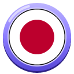
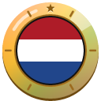
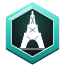
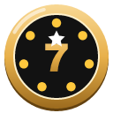

# Cogvivo: the real-life challenge app

**Stop scrolling. Collect the world for real.**

A free social app for real-life photo and video challenges, travel badges for 198 countries, 150 famous landmarks and monuments around the world. In 12 languages.

**[Open the badge gallery →](https://timmy5314.github.io/cogvivo-community/)**

## What is Cogvivo?

Cogvivo is a free social app where you **do** things instead of only watching them.

- **Real-life challenges.** Film yourself doing a challenge and post it. Other players give your attempt 0 to 5 stars. Challenge a friend, or a random player, to a duel.
- **Monuments and places.** Visit a monument and add it to your collection. Add a place that is not on the map yet and it says *discovered by you*.
- **Country badges.** Every country has its own badge and five lifelong challenges. Finish all five and it turns into a superbadge.
- **Landmark badges.** The Eiffel Tower, the Great Wall of China, Machu Picchu and 147 more famous places each have a unique badge.
- **Everywhere.** Free on [cogvivo.com](https://cogvivo.com), installable as an app on any phone, in 12 languages.

## Explore

| | |
|---|---|
| 🎯 [**93 challenges**](challenges/README.md) | Everything you can do, with a link to each one in the app |
| ⚔️ [**Duels**](challenges/duels.md) | Do the same thing as someone else and let viewers decide |
| 🌍 [**198 countries**](challenges/countries/README.md) | Five challenges per country, by continent |
| 🏅 [**Badge gallery**](https://timmy5314.github.io/cogvivo-community/) | [Achievements](https://timmy5314.github.io/cogvivo-community/badges/), [countries](https://timmy5314.github.io/cogvivo-community/countries/) and [landmarks](https://timmy5314.github.io/cogvivo-community/landmarks/) |
| 🗣️ [**Translations**](translations/README.md) | Every app text in 12 languages |
| 🛠️ [**How it is built**](HOW-IT-WORKS.md) | SvelteKit on Cloudflare Workers, Supabase, 12 languages |

## Help make Cogvivo

This repository is the public place to help. The source code of the app itself is private.

| What | How |
|---|---|
| 🌍 **Translate** | Improve your language or add a new one in [`translations/`](translations/). No coding needed. Start with a [`good first issue`](https://github.com/Timmy5314/cogvivo-community/labels/good%20first%20issue). |
| 💡 **Ideas** | Suggest a challenge, a place or a feature in [Discussions](https://github.com/Timmy5314/cogvivo-community/discussions). |
| 🐞 **Bugs** | [Open an issue](https://github.com/Timmy5314/cogvivo-community/issues/new/choose). |
| 🔒 **Security** | Report it privately via [*Security → Report a vulnerability*](https://github.com/Timmy5314/cogvivo-community/security/advisories/new), never in a public issue. See [SECURITY.md](SECURITY.md). |
| 🧑‍💻 **Build along** | [Tell us what you would like to work on](https://github.com/Timmy5314/cogvivo-community/issues/new/choose). People who help actively can be invited to the private code. |

Read [CONTRIBUTING.md](CONTRIBUTING.md) before you start. Everything in `translations/`, `challenges/` and `badges/` is updated automatically from the app.

## Play in your language

[English](https://cogvivo.com/en) · [Nederlands](https://cogvivo.com/nl) · [Deutsch](https://cogvivo.com/de) · [Français](https://cogvivo.com/fr) · [Español](https://cogvivo.com/es) · [Português](https://cogvivo.com/pt) · [Italiano](https://cogvivo.com/it) · [Polski](https://cogvivo.com/pl) · [Türkçe](https://cogvivo.com/tr) · [العربية](https://cogvivo.com/ar) · [Bahasa Indonesia](https://cogvivo.com/id) · [日本語](https://cogvivo.com/ja)

---

**Created by [Tim Wijnands](https://github.com/Timmy5314).** See [AUTHORSHIP.md](AUTHORSHIP.md) for the dated proof.

© 2026 Tim Wijnands. Cogvivo™ and all names, texts, challenges, badges and designs here are protected. Public to view and to help with, **not** to copy or reuse; see [LICENSE](LICENSE). Flags: [flag-icons](https://github.com/lipis/flag-icons) (MIT).
