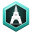
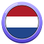

# Cogvivo™

**Doe het echt. Verzamel het. Deel het.** · *Do it for real. Collect it. Share it.*

  
  
  
  
  

Cogvivo is een sociaal platform waar je echte dingen doet in plaats van alleen te scrollen. Je doet challenges en verdient daarmee sterren. Je verzamelt monumenten en landen over de hele wereld. Je bewijst het met je eigen foto of video. Het platform wordt gebouwd voor iedereen, in veel talen.

**Bedacht en gemaakt door [Tim Wijnands](https://github.com/Timmy5314).** Zie [MAKERSCHAP.md](MAKERSCHAP.md) voor het gedateerde bewijs.

## Help mee

Deze repository is de openbare plek om mee te helpen. De broncode is privé.

| Wat | Hoe |
|---|---|
| 🌍 **Vertalen** | Vertaal de app-teksten in [`vertalingen/`](vertalingen/) naar jouw taal en open een pull request. |
| 💡 **Ideeën** | Open een issue met het label *idee*, bijvoorbeeld voor een challenge, een plek of een functie. |
| 🐞 **Fouten** | Open een issue met het label *fout*. |
| 🔒 **Beveiligingslek** | Meld het privé via *Security → Report a vulnerability*, nooit in een openbaar issue. |
| 🧑‍💻 **Meebouwen** | Open een issue *Ik wil meebouwen*. Wie actief helpt, kan een uitnodiging krijgen voor de privé-repository. |

Lees voor je bijdraagt [BIJDRAGEN.md](BIJDRAGEN.md).

## English

Cogvivo is a social platform where you do real things instead of just scrolling. You complete challenges to earn stars, collect monuments and countries around the world, and prove each one with your own photo or video. It is built for everyone, in many languages. **Created by [Tim Wijnands](https://github.com/Timmy5314).** You can help with translations ([`vertalingen/`](vertalingen/)), ideas and bug reports through issues. Read [BIJDRAGEN.md](BIJDRAGEN.md) (contribution terms, with an English summary) before contributing.

---

© 2026 Tim Wijnands. Cogvivo™ and all names, texts, badges and designs here are protected. Public to view and to help, **not** to copy or reuse; see [LICENSE](LICENSE).
