# Badges

Every badge you can collect on Cogvivo, exactly as they appear in the app. **[▶ Start collecting](https://cogvivo.com)** · [See them as a gallery](https://timmy5314.github.io/cogvivo-community/)

## Stars and milestones

Earn stars with challenges; milestones grow with you.

      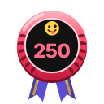        

## Monuments

One figure for every monument you visit. The plinth turns stone, bronze, silver, gold and platinum.

           

## Countries

Every country has its own badge. Finish its five challenges and it becomes a superbadge.

  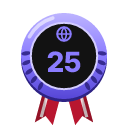 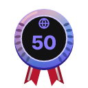

## Discoverer

Add a place that is not on the map yet. When the community approves it, it says "discovered by you".

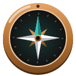 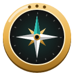 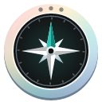 

## Reviewer

Help the community judge visits, challenges and discoveries.

           

## Daily challenge

Do the daily challenge seven days in a row.

   

## Countries (198)

 <a href="https://cogvivo.com/en/country/AL">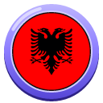</a> <a href="https://cogvivo.com/en/country/DZ">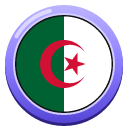</a>   <a href="https://cogvivo.com/en/country/AG">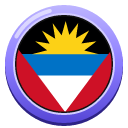</a>     <a href="https://cogvivo.com/en/country/AZ">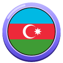</a>     <a href="https://cogvivo.com/en/country/BY">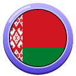</a>  <a href="https://cogvivo.com/en/country/BZ">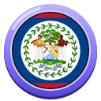</a>       <a href="https://cogvivo.com/en/country/BN">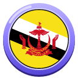</a> <a href="https://cogvivo.com/en/country/BG">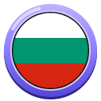</a> <a href="https://cogvivo.com/en/country/BF">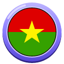</a>    <a href="https://cogvivo.com/en/country/CM">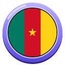</a>   <a href="https://cogvivo.com/en/country/TD">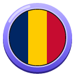</a> <a href="https://cogvivo.com/en/country/CL">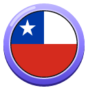</a>  <a href="https://cogvivo.com/en/country/CO">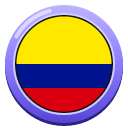</a> <a href="https://cogvivo.com/en/country/KM">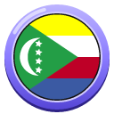</a> <a href="https://cogvivo.com/en/country/CR">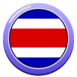</a>      <a href="https://cogvivo.com/en/country/CD">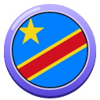</a> <a href="https://cogvivo.com/en/country/DK">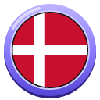</a>   <a href="https://cogvivo.com/en/country/DO">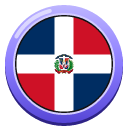</a> <a href="https://cogvivo.com/en/country/EC">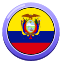</a> <a href="https://cogvivo.com/en/country/EG">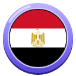</a>  <a href="https://cogvivo.com/en/country/GQ">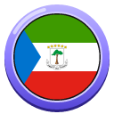</a> <a href="https://cogvivo.com/en/country/ER">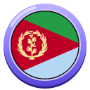</a> <a href="https://cogvivo.com/en/country/EE">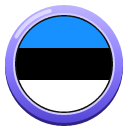</a>    <a href="https://cogvivo.com/en/country/FI">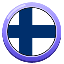</a> <a href="https://cogvivo.com/en/country/FR">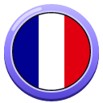</a> <a href="https://cogvivo.com/en/country/GA">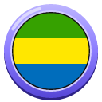</a> <a href="https://cogvivo.com/en/country/GM">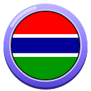</a> <a href="https://cogvivo.com/en/country/GE">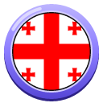</a>   <a href="https://cogvivo.com/en/country/GR">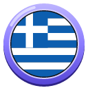</a>  <a href="https://cogvivo.com/en/country/GT">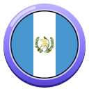</a>  <a href="https://cogvivo.com/en/country/GW">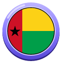</a> <a href="https://cogvivo.com/en/country/GY">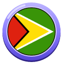</a>   <a href="https://cogvivo.com/en/country/HU">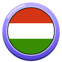</a>   <a href="https://cogvivo.com/en/country/ID">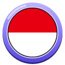</a>        <a href="https://cogvivo.com/en/country/JO">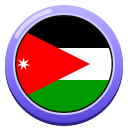</a>   <a href="https://cogvivo.com/en/country/KI">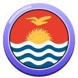</a>  <a href="https://cogvivo.com/en/country/KW">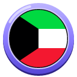</a> <a href="https://cogvivo.com/en/country/KG">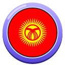</a>  <a href="https://cogvivo.com/en/country/LV">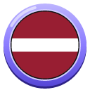</a>  <a href="https://cogvivo.com/en/country/LS">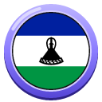</a>  <a href="https://cogvivo.com/en/country/LY">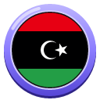</a>  <a href="https://cogvivo.com/en/country/LT">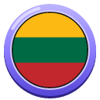</a>      <a href="https://cogvivo.com/en/country/ML">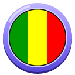</a> <a href="https://cogvivo.com/en/country/MT">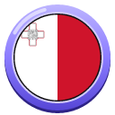</a>                                                                                            

## Icon badges (150)

A unique badge for the world's most famous places. Visit the place and it is yours for life.

                                                                                                                                                     

---

© 2026 Tim Wijnands. Cogvivo™, its texts, challenges and badges are protected: public to view and to help with, not to copy or reuse. See [LICENSE](../LICENSE).

*This page is generated automatically from the app. Changes made here by hand are overwritten.*
