# Badges

Every badge you can collect on Cogvivo, exactly as they appear in the app. **[▶ Start collecting](https://cogvivo.com)** · [Open the gallery](https://timmy5314.github.io/cogvivo-community/badges/)

## Stars and milestones

Every challenge you post can earn up to 5 stars from viewers. Milestones grow with you.

           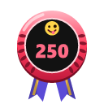 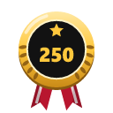  

## Duels

Challenge a friend or a random player to do the same thing. Viewers decide who did it best.

 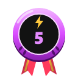 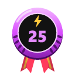 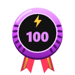

## Monuments

One figure for every monument you visit. The plinth turns stone, bronze, silver, gold and platinum.

          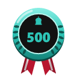 

## Countries

Every country has its own badge. Collect them all over the world.

   

## Discoverer

Add a place that is not on the map yet. When the community approves it, it says "discovered by you".

 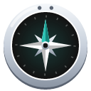  

## Reviewer

Help the community judge visits, challenges and discoveries.

  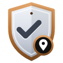         

## Daily challenge

Do the daily challenge seven days in a row.

   

## Countries (198)

<a href="https://cogvivo.com/en/country/AF">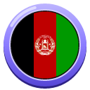</a>   <a href="https://cogvivo.com/en/country/AD">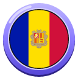</a> <a href="https://cogvivo.com/en/country/AO">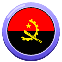</a>  <a href="https://cogvivo.com/en/country/AR">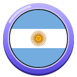</a> <a href="https://cogvivo.com/en/country/AM">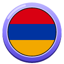</a>  <a href="https://cogvivo.com/en/country/AT">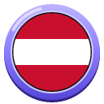</a>  <a href="https://cogvivo.com/en/country/BS">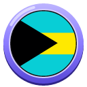</a> <a href="https://cogvivo.com/en/country/BH">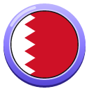</a> <a href="https://cogvivo.com/en/country/BD">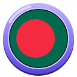</a> <a href="https://cogvivo.com/en/country/BB">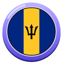</a>    <a href="https://cogvivo.com/en/country/BJ">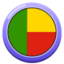</a>  <a href="https://cogvivo.com/en/country/BO">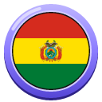</a> <a href="https://cogvivo.com/en/country/BA">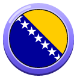</a> <a href="https://cogvivo.com/en/country/BW">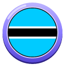</a> <a href="https://cogvivo.com/en/country/BR">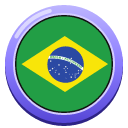</a>    <a href="https://cogvivo.com/en/country/BI">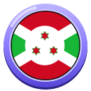</a> <a href="https://cogvivo.com/en/country/CV">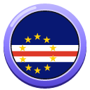</a> <a href="https://cogvivo.com/en/country/KH">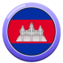</a>   <a href="https://cogvivo.com/en/country/CF">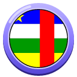</a>   <a href="https://cogvivo.com/en/country/CN">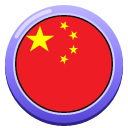</a>    <a href="https://cogvivo.com/en/country/CI">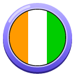</a> <a href="https://cogvivo.com/en/country/HR">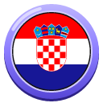</a> <a href="https://cogvivo.com/en/country/CU">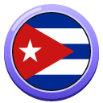</a> <a href="https://cogvivo.com/en/country/CY">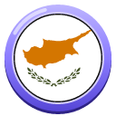</a> <a href="https://cogvivo.com/en/country/CZ">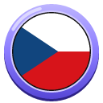</a>   <a href="https://cogvivo.com/en/country/DJ">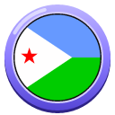</a> <a href="https://cogvivo.com/en/country/DM">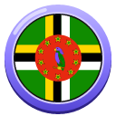</a>    <a href="https://cogvivo.com/en/country/SV">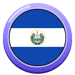</a>    <a href="https://cogvivo.com/en/country/SZ">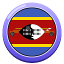</a> <a href="https://cogvivo.com/en/country/ET">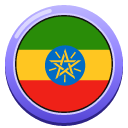</a> <a href="https://cogvivo.com/en/country/FJ">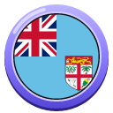</a>      <a href="https://cogvivo.com/en/country/DE">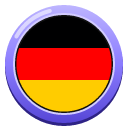</a> <a href="https://cogvivo.com/en/country/GH">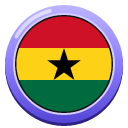</a>    <a href="https://cogvivo.com/en/country/GN">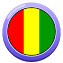</a>   <a href="https://cogvivo.com/en/country/HT">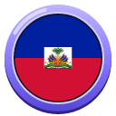</a> <a href="https://cogvivo.com/en/country/HN">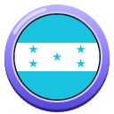</a>  <a href="https://cogvivo.com/en/country/IS">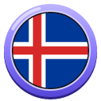</a>   <a href="https://cogvivo.com/en/country/IR">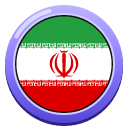</a> <a href="https://cogvivo.com/en/country/IQ">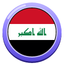</a> <a href="https://cogvivo.com/en/country/IE">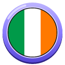</a> <a href="https://cogvivo.com/en/country/IL">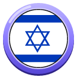</a> <a href="https://cogvivo.com/en/country/IT">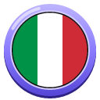</a>                                                                                                                    

## Landmarks (150)

A unique badge for the world's most famous places. Visit the place and it is yours for life.

                                                                                                                                                     

---

© 2026 Tim Wijnands. Cogvivo™, its texts, challenges and badges are protected: public to view and to help with, not to copy or reuse. See [LICENSE](../LICENSE).

*This page is generated automatically from the app. Changes made here by hand are overwritten.*
