# Country challenges: Africa

[← All continents](README.md)

## Algeria

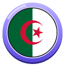 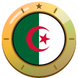

1. [Photograph the whole Notre-Dame d’Afrique basilica in daylight.](https://cogvivo.com/en/challenge/land-dz-1)
2. [Take a selfie in the Casbah of Algiers with the old streets behind you.](https://cogvivo.com/en/challenge/land-dz-2)
3. [Photograph a monument outside Algiers in daylight: choose one from the list.](https://cogvivo.com/en/challenge/land-dz-3)
4. [Taste karantika (chickpea flan) or couscous. Film your reaction.](https://cogvivo.com/en/challenge/land-dz-4)
5. [Film yourself: say hello and order something in Algerian Arabic.](https://cogvivo.com/en/challenge/land-dz-5)

**[▶ Open Algeria on Cogvivo](https://cogvivo.com/en/country/DZ)**

## Angola

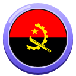 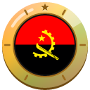

1. [Photograph the whole Iron Palace in Luanda in daylight.](https://cogvivo.com/en/challenge/land-ao-1)
2. [Take a selfie on the Luanda waterfront with the bay behind you.](https://cogvivo.com/en/challenge/land-ao-2)
3. [Photograph a monument outside Luanda in daylight: choose one from the list.](https://cogvivo.com/en/challenge/land-ao-3)
4. [Taste moamba de galinha or feijão de óleo de palma (beans). Film your reaction.](https://cogvivo.com/en/challenge/land-ao-4)
5. [Film yourself: say hello and order something in Portuguese.](https://cogvivo.com/en/challenge/land-ao-5)

**[▶ Open Angola on Cogvivo](https://cogvivo.com/en/country/AO)**

## Benin

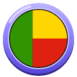 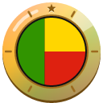

1. [Photograph the whole Amazon Statue in Cotonou in daylight.](https://cogvivo.com/en/challenge/land-bj-1)
2. [Take a selfie with the Notre-Dame Cathedral of Cotonou behind you.](https://cogvivo.com/en/challenge/land-bj-2)
3. [Photograph a monument outside Cotonou in daylight: choose one from the list.](https://cogvivo.com/en/challenge/land-bj-3)
4. [Taste amiwo or aloko (fried plantain). Film your reaction.](https://cogvivo.com/en/challenge/land-bj-4)
5. [Film yourself: say hello and thank you in Fon.](https://cogvivo.com/en/challenge/land-bj-5)

**[▶ Open Benin on Cogvivo](https://cogvivo.com/en/country/BJ)**

## Botswana

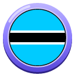 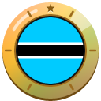

1. [Photograph an elephant in Chobe National Park. Stay in the vehicle or boat.](https://cogvivo.com/en/challenge/land-bw-1)
2. [Take a selfie with the Chobe River behind you.](https://cogvivo.com/en/challenge/land-bw-2)
3. [Photograph a monument outside Kasane in daylight: choose one from the list.](https://cogvivo.com/en/challenge/land-bw-3)
4. [Taste seswaa (pounded beef) or morogo (wild spinach) with pap. Film your reaction.](https://cogvivo.com/en/challenge/land-bw-4)
5. [Film yourself: say hello and thank you in Setswana.](https://cogvivo.com/en/challenge/land-bw-5)

**[▶ Open Botswana on Cogvivo](https://cogvivo.com/en/country/BW)**

## Burkina Faso

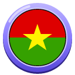 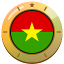

1. [Photograph the whole Ouagadougou Cathedral in daylight.](https://cogvivo.com/en/challenge/land-bf-1)
2. [Take a selfie at the Filmmakers' Monument in Ouagadougou.](https://cogvivo.com/en/challenge/land-bf-2)
3. [Photograph a well-known place outside Ouagadougou in daylight: choose one from the list.](https://cogvivo.com/en/challenge/land-bf-3)
4. [Taste tô with okra sauce or riz gras. Film your reaction.](https://cogvivo.com/en/challenge/land-bf-4)
5. [Film yourself: say hello and thank you in Mooré.](https://cogvivo.com/en/challenge/land-bf-5)

**[▶ Open Burkina Faso on Cogvivo](https://cogvivo.com/en/country/BF)**

## Burundi

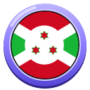 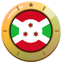

1. [Photograph Lake Tanganyika from the beach in Bujumbura in daylight.](https://cogvivo.com/en/challenge/land-bi-1)
2. [Take a selfie at the Livingstone–Stanley Monument near Bujumbura.](https://cogvivo.com/en/challenge/land-bi-2)
3. [Photograph a monument outside Bujumbura in daylight: choose one from the list.](https://cogvivo.com/en/challenge/land-bi-3)
4. [Taste isombe (cassava leaves) or beans with plantain. Film your reaction.](https://cogvivo.com/en/challenge/land-bi-4)
5. [Film yourself: say hello and thank you in Kirundi.](https://cogvivo.com/en/challenge/land-bi-5)

**[▶ Open Burundi on Cogvivo](https://cogvivo.com/en/country/BI)**

## Cabo Verde

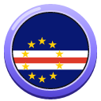 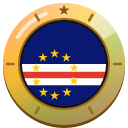

1. [Photograph the Santa Maria pier in daylight.](https://cogvivo.com/en/challenge/land-cv-1)
2. [Take a selfie while floating in the Pedra de Lume salt pans.](https://cogvivo.com/en/challenge/land-cv-2)
3. [Photograph a monument outside Santa Maria in daylight: choose one from the list.](https://cogvivo.com/en/challenge/land-cv-3)
4. [Taste cachupa or grilled fish. Film your reaction.](https://cogvivo.com/en/challenge/land-cv-4)
5. [Film yourself: say hello and thank you in Cape Verdean Creole.](https://cogvivo.com/en/challenge/land-cv-5)

**[▶ Open Cabo Verde on Cogvivo](https://cogvivo.com/en/country/CV)**

## Cameroon

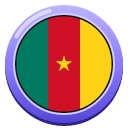 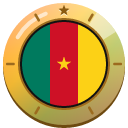

1. [Photograph the whole Saints Peter and Paul Cathedral of Douala in daylight.](https://cogvivo.com/en/challenge/land-cm-1)
2. [Take a selfie with the statue La Nouvelle Liberté behind you.](https://cogvivo.com/en/challenge/land-cm-2)
3. [Photograph a monument outside Douala in daylight: choose one from the list.](https://cogvivo.com/en/challenge/land-cm-3)
4. [Taste ndolé or beignets-haricots (beans with puff-puff). Film your reaction.](https://cogvivo.com/en/challenge/land-cm-4)
5. [Film yourself: say hello and order something in French.](https://cogvivo.com/en/challenge/land-cm-5)

**[▶ Open Cameroon on Cogvivo](https://cogvivo.com/en/country/CM)**

## Central African Republic

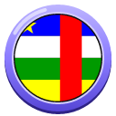 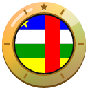

1. [Photograph the whole Notre-Dame Cathedral of Bangui in daylight.](https://cogvivo.com/en/challenge/land-cf-1)
2. [Take a selfie on the bank of the Ubangi River in Bangui.](https://cogvivo.com/en/challenge/land-cf-2)
3. [Photograph a well-known place outside Bangui in daylight: choose one from the list.](https://cogvivo.com/en/challenge/land-cf-3)
4. [Taste ngunza (cassava leaves) or fried plantain with peanut sauce. Film your reaction.](https://cogvivo.com/en/challenge/land-cf-4)
5. [Film yourself: say hello and thank you in Sango.](https://cogvivo.com/en/challenge/land-cf-5)

**[▶ Open Central African Republic on Cogvivo](https://cogvivo.com/en/country/CF)**

## Chad

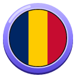 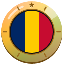

1. [Photograph the whole Grand Mosque of N’Djamena in daylight.](https://cogvivo.com/en/challenge/land-td-1)
2. [Take a selfie on the bank of the Chari River in N’Djamena.](https://cogvivo.com/en/challenge/land-td-2)
3. [Photograph a well-known place outside N’Djamena in daylight: choose one from the list.](https://cogvivo.com/en/challenge/land-td-3)
4. [Taste daraba (okra stew) with boule or karkanji (hibiscus tea). Film your reaction.](https://cogvivo.com/en/challenge/land-td-4)
5. [Film yourself: say hello and thank you in Chadian Arabic.](https://cogvivo.com/en/challenge/land-td-5)

**[▶ Open Chad on Cogvivo](https://cogvivo.com/en/country/TD)**

## Comoros

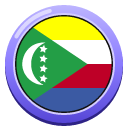 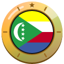

1. [Photograph the Old Friday Mosque at Moroni harbour in daylight.](https://cogvivo.com/en/challenge/land-km-1)
2. [Take a selfie at the old harbour of Moroni.](https://cogvivo.com/en/challenge/land-km-2)
3. [Photograph a well-known place outside Moroni in daylight: choose one from the list.](https://cogvivo.com/en/challenge/land-km-3)
4. [Taste mataba (cassava leaves in coconut) or pilaou. Film your reaction.](https://cogvivo.com/en/challenge/land-km-4)
5. [Film yourself: say hello and thank you in Comorian.](https://cogvivo.com/en/challenge/land-km-5)

**[▶ Open Comoros on Cogvivo](https://cogvivo.com/en/country/KM)**

## Côte d'Ivoire

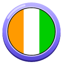 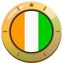

1. [Photograph the whole St. Paul's Cathedral in Abidjan in daylight.](https://cogvivo.com/en/challenge/land-ci-1)
2. [Take a selfie with the Le Plateau skyline behind you.](https://cogvivo.com/en/challenge/land-ci-2)
3. [Photograph a monument outside Abidjan in daylight: choose one from the list.](https://cogvivo.com/en/challenge/land-ci-3)
4. [Taste attiéké with fish or alloco (fried plantain). Film your reaction.](https://cogvivo.com/en/challenge/land-ci-4)
5. [Film yourself: say hello and order something in French.](https://cogvivo.com/en/challenge/land-ci-5)

**[▶ Open Côte d'Ivoire on Cogvivo](https://cogvivo.com/en/country/CI)**

## Democratic Republic of the Congo

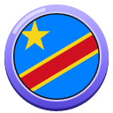 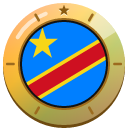

1. [Photograph the whole Notre-Dame du Congo Cathedral in Kinshasa in daylight.](https://cogvivo.com/en/challenge/land-cd-1)
2. [Take a selfie at the Lola ya Bonobo sanctuary with the bonobos behind you.](https://cogvivo.com/en/challenge/land-cd-2)
3. [Photograph a well-known place outside Kinshasa in daylight: choose one from the list.](https://cogvivo.com/en/challenge/land-cd-3)
4. [Taste liboké (fish in leaves) or pondu (cassava leaves). Film your reaction.](https://cogvivo.com/en/challenge/land-cd-4)
5. [Film yourself: say hello and thank you in Lingala.](https://cogvivo.com/en/challenge/land-cd-5)

**[▶ Open Democratic Republic of the Congo on Cogvivo](https://cogvivo.com/en/country/CD)**

## Djibouti

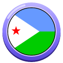 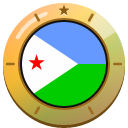

1. [Photograph the whole Hamoudi Mosque in Djibouti City in daylight.](https://cogvivo.com/en/challenge/land-dj-1)
2. [Take a selfie on Menelik Square in Djibouti City.](https://cogvivo.com/en/challenge/land-dj-2)
3. [Photograph a well-known place outside Djibouti City in daylight: choose one from the list.](https://cogvivo.com/en/challenge/land-dj-3)
4. [Taste skoudehkaris (spiced rice) or laxoox (pancake bread). Film your reaction.](https://cogvivo.com/en/challenge/land-dj-4)
5. [Film yourself: say hello and order something in Somali.](https://cogvivo.com/en/challenge/land-dj-5)

**[▶ Open Djibouti on Cogvivo](https://cogvivo.com/en/country/DJ)**

## Egypt

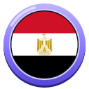 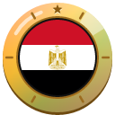

1. [Photograph the whole Giza pyramids in daylight.](https://cogvivo.com/en/challenge/land-eg-1)
2. [Take a selfie with the Muhammad Ali Mosque at the Cairo Citadel behind you.](https://cogvivo.com/en/challenge/land-eg-2)
3. [Photograph a monument outside Cairo in daylight: choose one from the list.](https://cogvivo.com/en/challenge/land-eg-3)
4. [Taste koshari or ful medames. Film your reaction.](https://cogvivo.com/en/challenge/land-eg-4)
5. [Film yourself: say hello and order something in Egyptian Arabic.](https://cogvivo.com/en/challenge/land-eg-5)

**[▶ Open Egypt on Cogvivo](https://cogvivo.com/en/country/EG)**

## Equatorial Guinea

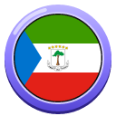 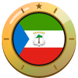

1. [Photograph the whole Malabo Cathedral in daylight.](https://cogvivo.com/en/challenge/land-gq-1)
2. [Take a selfie on Arena Blanca beach.](https://cogvivo.com/en/challenge/land-gq-2)
3. [Photograph a well-known place outside Malabo in daylight: choose one from the list.](https://cogvivo.com/en/challenge/land-gq-3)
4. [Taste pepper soup (fish soup) or fried plantain. Film your reaction.](https://cogvivo.com/en/challenge/land-gq-4)
5. [Film yourself: say hello and order something in Spanish.](https://cogvivo.com/en/challenge/land-gq-5)

**[▶ Open Equatorial Guinea on Cogvivo](https://cogvivo.com/en/country/GQ)**

## Eritrea

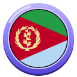 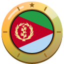

1. [Photograph the whole Fiat Tagliero Building in Asmara in daylight.](https://cogvivo.com/en/challenge/land-er-1)
2. [Take a selfie with Asmara Cathedral behind you.](https://cogvivo.com/en/challenge/land-er-2)
3. [Photograph a monument outside Asmara in daylight: choose one from the list.](https://cogvivo.com/en/challenge/land-er-3)
4. [Taste shiro (chickpea stew) or zigni with injera. Film your reaction.](https://cogvivo.com/en/challenge/land-er-4)
5. [Film yourself: say hello and order something in Tigrinya.](https://cogvivo.com/en/challenge/land-er-5)

**[▶ Open Eritrea on Cogvivo](https://cogvivo.com/en/country/ER)**

## Eswatini

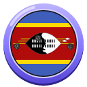 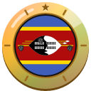

1. [Photograph the whole Sibebe Rock near Mbabane in daylight.](https://cogvivo.com/en/challenge/land-sz-1)
2. [Take a selfie with Mantenga Falls behind you.](https://cogvivo.com/en/challenge/land-sz-2)
3. [Photograph a well-known place outside Mbabane in daylight: choose one from the list.](https://cogvivo.com/en/challenge/land-sz-3)
4. [Taste sidvudvu (pumpkin porridge) or sishwala with meat. Film your reaction.](https://cogvivo.com/en/challenge/land-sz-4)
5. [Film yourself: say hello and thank you in siSwati.](https://cogvivo.com/en/challenge/land-sz-5)

**[▶ Open Eswatini on Cogvivo](https://cogvivo.com/en/country/SZ)**

## Ethiopia

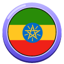 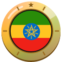

1. [Photograph the whole Holy Trinity Cathedral in Addis Ababa in daylight.](https://cogvivo.com/en/challenge/land-et-1)
2. [Take a selfie on Entoto with Addis Ababa behind you.](https://cogvivo.com/en/challenge/land-et-2)
3. [Photograph a monument outside Addis Ababa in daylight: choose one from the list.](https://cogvivo.com/en/challenge/land-et-3)
4. [Taste doro wat or beyaynetu (vegetarian platter) with injera. Film your reaction.](https://cogvivo.com/en/challenge/land-et-4)
5. [Film an Ethiopian coffee ceremony: roasting, grinding or pouring the coffee.](https://cogvivo.com/en/challenge/land-et-5)

**[▶ Open Ethiopia on Cogvivo](https://cogvivo.com/en/country/ET)**

## Gabon

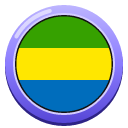 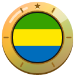

1. [Photograph St. Michael's Church of Nkembo in Libreville in daylight.](https://cogvivo.com/en/challenge/land-ga-1)
2. [Take a selfie on the beach at Pointe Denis.](https://cogvivo.com/en/challenge/land-ga-2)
3. [Photograph a monument outside Libreville in daylight: choose one from the list.](https://cogvivo.com/en/challenge/land-ga-3)
4. [Taste poulet nyembwe (chicken in palm nut sauce) or fried plantain. Film your reaction.](https://cogvivo.com/en/challenge/land-ga-4)
5. [Film yourself: say hello and order something in French.](https://cogvivo.com/en/challenge/land-ga-5)

**[▶ Open Gabon on Cogvivo](https://cogvivo.com/en/country/GA)**

## Gambia

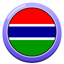 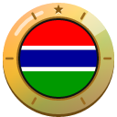

1. [Photograph the Kachikally Crocodile Pool in Bakau.](https://cogvivo.com/en/challenge/land-gm-1)
2. [Take a selfie on Kotu beach.](https://cogvivo.com/en/challenge/land-gm-2)
3. [Photograph a monument outside Banjul in daylight: choose one from the list.](https://cogvivo.com/en/challenge/land-gm-3)
4. [Taste domoda (peanut stew) or benachin. Film your reaction.](https://cogvivo.com/en/challenge/land-gm-4)
5. [Film yourself: say hello and thank you in Mandinka.](https://cogvivo.com/en/challenge/land-gm-5)

**[▶ Open Gambia on Cogvivo](https://cogvivo.com/en/country/GM)**

## Ghana

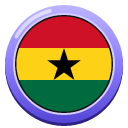 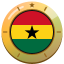

1. [Photograph the whole Jamestown Lighthouse in daylight.](https://cogvivo.com/en/challenge/land-gh-1)
2. [Take a selfie on Labadi Beach.](https://cogvivo.com/en/challenge/land-gh-2)
3. [Photograph a well-known place outside Accra in daylight: choose one from the list.](https://cogvivo.com/en/challenge/land-gh-3)
4. [Taste jollof rice or red-red (beans with plantain). Film your reaction.](https://cogvivo.com/en/challenge/land-gh-4)
5. [Film yourself: say hello and thank you in Twi.](https://cogvivo.com/en/challenge/land-gh-5)

**[▶ Open Ghana on Cogvivo](https://cogvivo.com/en/country/GH)**

## Guinea

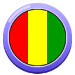 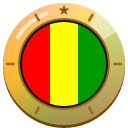

1. [Photograph the whole Grand Mosque of Conakry in daylight.](https://cogvivo.com/en/challenge/land-gn-1)
2. [Take a selfie on a beach of the Îles de Los.](https://cogvivo.com/en/challenge/land-gn-2)
3. [Photograph a well-known place outside Conakry in daylight: choose one from the list.](https://cogvivo.com/en/challenge/land-gn-3)
4. [Taste rice with peanut sauce or poulet yassa. Film your reaction.](https://cogvivo.com/en/challenge/land-gn-4)
5. [Film yourself: say hello and thank you in Susu.](https://cogvivo.com/en/challenge/land-gn-5)

**[▶ Open Guinea on Cogvivo](https://cogvivo.com/en/country/GN)**

## Guinea-Bissau

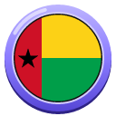 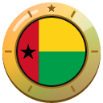

1. [Photograph the whole Bissau Cathedral in daylight.](https://cogvivo.com/en/challenge/land-gw-1)
2. [Take a selfie in the old quarter of Bissau Velho.](https://cogvivo.com/en/challenge/land-gw-2)
3. [Photograph a well-known place outside Bissau in daylight: choose one from the list.](https://cogvivo.com/en/challenge/land-gw-3)
4. [Taste caldo de mancarra (peanut stew) or grilled fish with rice. Film your reaction.](https://cogvivo.com/en/challenge/land-gw-4)
5. [Film yourself: say hello and thank you in Guinea-Bissau Creole.](https://cogvivo.com/en/challenge/land-gw-5)

**[▶ Open Guinea-Bissau on Cogvivo](https://cogvivo.com/en/country/GW)**

## Kenya

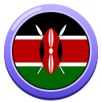 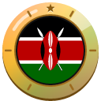

1. [Photograph a giraffe at the Giraffe Centre in Nairobi.](https://cogvivo.com/en/challenge/land-ke-1)
2. [Take a selfie on the KICC rooftop with the Nairobi skyline.](https://cogvivo.com/en/challenge/land-ke-2)
3. [Photograph a well-known place outside Nairobi in daylight: choose one from the list.](https://cogvivo.com/en/challenge/land-ke-3)
4. [Taste ugali with sukuma wiki (collard greens) or nyama choma. Film your reaction.](https://cogvivo.com/en/challenge/land-ke-4)
5. [Film yourself: say hello and order something in Swahili.](https://cogvivo.com/en/challenge/land-ke-5)

**[▶ Open Kenya on Cogvivo](https://cogvivo.com/en/country/KE)**

## Lesotho

 

1. [Photograph the whole Basotho Hat building in Maseru in daylight.](https://cogvivo.com/en/challenge/land-ls-1)
2. [Take a selfie with Qiloane hill at Thaba Bosiu behind you.](https://cogvivo.com/en/challenge/land-ls-2)
3. [Photograph a well-known place outside Maseru in daylight: choose one from the list.](https://cogvivo.com/en/challenge/land-ls-3)
4. [Taste papa with moroho (greens) or chakalaka. Film your reaction.](https://cogvivo.com/en/challenge/land-ls-4)
5. [Film yourself: say hello and thank you in Sesotho.](https://cogvivo.com/en/challenge/land-ls-5)

**[▶ Open Lesotho on Cogvivo](https://cogvivo.com/en/country/LS)**

## Liberia

 

1. [Photograph the whole National Museum of Liberia in daylight.](https://cogvivo.com/en/challenge/land-lr-1)
2. [Take a selfie on CeCe Beach in Monrovia.](https://cogvivo.com/en/challenge/land-lr-2)
3. [Photograph a well-known place outside Monrovia in daylight: choose one from the list.](https://cogvivo.com/en/challenge/land-lr-3)
4. [Taste palm butter (palm nut stew) or potato greens. Film your reaction.](https://cogvivo.com/en/challenge/land-lr-4)
5. [Film yourself: say hello and thank you in Kpelle.](https://cogvivo.com/en/challenge/land-lr-5)

**[▶ Open Liberia on Cogvivo](https://cogvivo.com/en/country/LR)**

## Libya

 

1. [Photograph the whole Arch of Marcus Aurelius in Tripoli in daylight.](https://cogvivo.com/en/challenge/land-ly-1)
2. [Take a selfie with the Red Castle of Tripoli behind you.](https://cogvivo.com/en/challenge/land-ly-2)
3. [Photograph a monument outside Tripoli in daylight: choose one from the list.](https://cogvivo.com/en/challenge/land-ly-3)
4. [Taste bazeen or shorba libiya (Libyan soup). Film your reaction.](https://cogvivo.com/en/challenge/land-ly-4)
5. [Film yourself: say hello and thank you in Libyan Arabic.](https://cogvivo.com/en/challenge/land-ly-5)

**[▶ Open Libya on Cogvivo](https://cogvivo.com/en/country/LY)**

## Madagascar

 

1. [Photograph the whole Rova of Antananarivo in daylight.](https://cogvivo.com/en/challenge/land-mg-1)
2. [Take a selfie on the Royal Hill of Ambohimanga.](https://cogvivo.com/en/challenge/land-mg-2)
3. [Photograph a well-known place outside Antananarivo in daylight: choose one from the list.](https://cogvivo.com/en/challenge/land-mg-3)
4. [Taste romazava or mofo gasy (rice cakes). Film your reaction.](https://cogvivo.com/en/challenge/land-mg-4)
5. [Film yourself: say hello and order something in Malagasy.](https://cogvivo.com/en/challenge/land-mg-5)

**[▶ Open Madagascar on Cogvivo](https://cogvivo.com/en/country/MG)**

## Malawi

 

1. [Photograph an animal at the Lilongwe Wildlife Centre.](https://cogvivo.com/en/challenge/land-mw-1)
2. [Take a selfie with Lake Malawi at Senga Bay behind you.](https://cogvivo.com/en/challenge/land-mw-2)
3. [Photograph a monument outside Lilongwe in daylight: choose one from the list.](https://cogvivo.com/en/challenge/land-mw-3)
4. [Taste nsima with chambo (fish) or nsima with ndiwo (greens). Film your reaction.](https://cogvivo.com/en/challenge/land-mw-4)
5. [Film yourself: say hello and thank you in Chichewa.](https://cogvivo.com/en/challenge/land-mw-5)

**[▶ Open Malawi on Cogvivo](https://cogvivo.com/en/country/MW)**

## Mali

 

1. [Photograph the whole Grand Mosque of Bamako in daylight.](https://cogvivo.com/en/challenge/land-ml-1)
2. [Take a selfie in the National Park of Mali in Bamako.](https://cogvivo.com/en/challenge/land-ml-2)
3. [Photograph a well-known place outside Bamako in daylight: choose one from the list.](https://cogvivo.com/en/challenge/land-ml-3)
4. [Taste tiguadèguèna (peanut stew) or fonio with vegetables. Film your reaction.](https://cogvivo.com/en/challenge/land-ml-4)
5. [Film yourself: say hello and thank you in Bambara.](https://cogvivo.com/en/challenge/land-ml-5)

**[▶ Open Mali on Cogvivo](https://cogvivo.com/en/country/ML)**

## Mauritania

 

1. [Photograph the whole Grand Mosque of Nouakchott in daylight.](https://cogvivo.com/en/challenge/land-mr-1)
2. [Take a selfie with the colourful fishing boats on the Nouakchott beach.](https://cogvivo.com/en/challenge/land-mr-2)
3. [Photograph a monument outside Nouakchott in daylight: choose one from the list.](https://cogvivo.com/en/challenge/land-mr-3)
4. [Drink the three glasses of Mauritanian tea and film the pouring.](https://cogvivo.com/en/challenge/land-mr-4)
5. [Film yourself: say hello and thank you in Hassaniya Arabic.](https://cogvivo.com/en/challenge/land-mr-5)

**[▶ Open Mauritania on Cogvivo](https://cogvivo.com/en/country/MR)**

## Mauritius

 

1. [Photograph the Caudan Waterfront in Port Louis in daylight.](https://cogvivo.com/en/challenge/land-mu-1)
2. [Take a selfie at Fort Adelaide with Port Louis behind you.](https://cogvivo.com/en/challenge/land-mu-2)
3. [Photograph a well-known place outside Port Louis in daylight: choose one from the list.](https://cogvivo.com/en/challenge/land-mu-3)
4. [Taste dholl puri or rougaille. Film your reaction.](https://cogvivo.com/en/challenge/land-mu-4)
5. [Film yourself: say hello and order something in Mauritian Creole.](https://cogvivo.com/en/challenge/land-mu-5)

**[▶ Open Mauritius on Cogvivo](https://cogvivo.com/en/country/MU)**

## Morocco

 

1. [Photograph the whole Koutoubia minaret in daylight.](https://cogvivo.com/en/challenge/land-ma-1)
2. [Take a selfie on Jemaa el-Fnaa square.](https://cogvivo.com/en/challenge/land-ma-2)
3. [Photograph a monument outside Marrakesh in daylight: choose one from the list.](https://cogvivo.com/en/challenge/land-ma-3)
4. [Taste a vegetable tagine or couscous. Film your reaction.](https://cogvivo.com/en/challenge/land-ma-4)
5. [Film yourself: say hello and order mint tea in Moroccan Arabic.](https://cogvivo.com/en/challenge/land-ma-5)

**[▶ Open Morocco on Cogvivo](https://cogvivo.com/en/country/MA)**

## Mozambique

 

1. [Photograph the whole Maputo Central Railway Station in daylight.](https://cogvivo.com/en/challenge/land-mz-1)
2. [Take a selfie with Maputo Cathedral behind you.](https://cogvivo.com/en/challenge/land-mz-2)
3. [Photograph a well-known place outside Maputo in daylight: choose one from the list.](https://cogvivo.com/en/challenge/land-mz-3)
4. [Taste matapa (cassava leaves with coconut) or frango à piri-piri. Film your reaction.](https://cogvivo.com/en/challenge/land-mz-4)
5. [Film yourself: say hello and order something in Portuguese.](https://cogvivo.com/en/challenge/land-mz-5)

**[▶ Open Mozambique on Cogvivo](https://cogvivo.com/en/country/MZ)**

## Namibia

 

1. [Photograph the whole Christ Church in Windhoek in daylight.](https://cogvivo.com/en/challenge/land-na-1)
2. [Take a selfie at the Gibeon meteorites in Post Street Mall.](https://cogvivo.com/en/challenge/land-na-2)
3. [Photograph a well-known place outside Windhoek in daylight: choose one from the list.](https://cogvivo.com/en/challenge/land-na-3)
4. [Taste kapana (grilled meat) or oshifima with vegetables. Film your reaction.](https://cogvivo.com/en/challenge/land-na-4)
5. [Film yourself: say hello and thank you in Oshiwambo.](https://cogvivo.com/en/challenge/land-na-5)

**[▶ Open Namibia on Cogvivo](https://cogvivo.com/en/country/NA)**

## Niger

 

1. [Photograph the whole Grand Mosque of Niamey in daylight.](https://cogvivo.com/en/challenge/land-ne-1)
2. [Take a selfie at the Boubou Hama National Museum in Niamey.](https://cogvivo.com/en/challenge/land-ne-2)
3. [Photograph a well-known place outside Niamey in daylight: choose one from the list.](https://cogvivo.com/en/challenge/land-ne-3)
4. [Taste dambou (millet couscous with moringa) or riz gras. Film your reaction.](https://cogvivo.com/en/challenge/land-ne-4)
5. [Film yourself: say hello and thank you in Zarma or Hausa.](https://cogvivo.com/en/challenge/land-ne-5)

**[▶ Open Niger on Cogvivo](https://cogvivo.com/en/country/NE)**

## Nigeria

 

1. [Photograph the whole National Theatre of Lagos in daylight.](https://cogvivo.com/en/challenge/land-ng-1)
2. [Take a selfie on the canopy walkway of the Lekki Conservation Centre.](https://cogvivo.com/en/challenge/land-ng-2)
3. [Photograph a monument outside Lagos in daylight: choose one from the list.](https://cogvivo.com/en/challenge/land-ng-3)
4. [Taste jollof rice or moi moi (bean pudding). Film your reaction.](https://cogvivo.com/en/challenge/land-ng-4)
5. [Film yourself: say hello and thank you in Yoruba.](https://cogvivo.com/en/challenge/land-ng-5)

**[▶ Open Nigeria on Cogvivo](https://cogvivo.com/en/country/NG)**

## Republic of the Congo

 

1. [Photograph the whole Basilica of Sainte-Anne in Brazzaville in daylight.](https://cogvivo.com/en/challenge/land-cg-1)
2. [Take a selfie at the Congo River rapids.](https://cogvivo.com/en/challenge/land-cg-2)
3. [Photograph a well-known place outside Brazzaville in daylight: choose one from the list.](https://cogvivo.com/en/challenge/land-cg-3)
4. [Taste saka-saka (cassava leaves) or poulet moambé. Film your reaction.](https://cogvivo.com/en/challenge/land-cg-4)
5. [Film yourself: say hello and thank you in Lingala.](https://cogvivo.com/en/challenge/land-cg-5)

**[▶ Open Republic of the Congo on Cogvivo](https://cogvivo.com/en/country/CG)**

## Rwanda

 

1. [Photograph the whole Kigali Convention Centre in daylight.](https://cogvivo.com/en/challenge/land-rw-1)
2. [Take a selfie on Mount Kigali with the city behind you.](https://cogvivo.com/en/challenge/land-rw-2)
3. [Photograph a monument outside Kigali in daylight: choose one from the list.](https://cogvivo.com/en/challenge/land-rw-3)
4. [Taste isombe (cassava leaves) or brochettes. Film your reaction.](https://cogvivo.com/en/challenge/land-rw-4)
5. [Film yourself: say hello and thank you in Kinyarwanda.](https://cogvivo.com/en/challenge/land-rw-5)

**[▶ Open Rwanda on Cogvivo](https://cogvivo.com/en/country/RW)**

## São Tomé and Príncipe

 

1. [Photograph the whole São Tomé Cathedral in daylight.](https://cogvivo.com/en/challenge/land-st-1)
2. [Take a selfie at the Fort of São Sebastião in São Tomé.](https://cogvivo.com/en/challenge/land-st-2)
3. [Photograph a well-known place outside São Tomé in daylight: choose one from the list.](https://cogvivo.com/en/challenge/land-st-3)
4. [Taste calulu or chocolate from a local cocoa plantation. Film your reaction.](https://cogvivo.com/en/challenge/land-st-4)
5. [Film yourself: say hello and order something in Portuguese.](https://cogvivo.com/en/challenge/land-st-5)

**[▶ Open São Tomé and Príncipe on Cogvivo](https://cogvivo.com/en/country/ST)**

## Senegal

 

1. [Photograph the whole African Renaissance Monument in daylight.](https://cogvivo.com/en/challenge/land-sn-1)
2. [Take a selfie with the Mamelles Lighthouse behind you.](https://cogvivo.com/en/challenge/land-sn-2)
3. [Photograph a monument outside Dakar in daylight: choose one from the list.](https://cogvivo.com/en/challenge/land-sn-3)
4. [Taste thiéboudienne or yassa. Film your reaction.](https://cogvivo.com/en/challenge/land-sn-4)
5. [Film yourself: say hello and thank you in Wolof.](https://cogvivo.com/en/challenge/land-sn-5)

**[▶ Open Senegal on Cogvivo](https://cogvivo.com/en/country/SN)**

## Seychelles

 

1. [Photograph the whole Clock Tower in Victoria in daylight.](https://cogvivo.com/en/challenge/land-sc-1)
2. [Take a selfie on Beau Vallon beach.](https://cogvivo.com/en/challenge/land-sc-2)
3. [Photograph a well-known place outside Victoria in daylight: choose one from the list.](https://cogvivo.com/en/challenge/land-sc-3)
4. [Taste Seychellois fish curry or ladob (banana in coconut milk). Film your reaction.](https://cogvivo.com/en/challenge/land-sc-4)
5. [Film yourself: say hello and order something in Seychellois Creole.](https://cogvivo.com/en/challenge/land-sc-5)

**[▶ Open Seychelles on Cogvivo](https://cogvivo.com/en/country/SC)**

## Sierra Leone

 

1. [Photograph the whole St. George's Cathedral in Freetown in daylight.](https://cogvivo.com/en/challenge/land-sl-1)
2. [Take a selfie on Lumley Beach.](https://cogvivo.com/en/challenge/land-sl-2)
3. [Photograph a well-known place outside Freetown in daylight: choose one from the list.](https://cogvivo.com/en/challenge/land-sl-3)
4. [Taste cassava leaf stew or groundnut soup. Film your reaction.](https://cogvivo.com/en/challenge/land-sl-4)
5. [Film yourself: say hello and order something in Krio.](https://cogvivo.com/en/challenge/land-sl-5)

**[▶ Open Sierra Leone on Cogvivo](https://cogvivo.com/en/country/SL)**

## Somalia

 

1. [Photograph the whole Mosque of Islamic Solidarity in Mogadishu in daylight.](https://cogvivo.com/en/challenge/land-so-1)
2. [Take a selfie on Lido Beach in Mogadishu.](https://cogvivo.com/en/challenge/land-so-2)
3. [Photograph a well-known place outside Mogadishu in daylight: choose one from the list.](https://cogvivo.com/en/challenge/land-so-3)
4. [Taste canjeero (pancake bread) or bariis iskukaris (spiced rice). Film your reaction.](https://cogvivo.com/en/challenge/land-so-4)
5. [Film yourself: say hello and thank you in Somali.](https://cogvivo.com/en/challenge/land-so-5)

**[▶ Open Somalia on Cogvivo](https://cogvivo.com/en/country/SO)**

## South Africa

 

1. [Photograph the whole of Table Mountain in daylight.](https://cogvivo.com/en/challenge/land-za-1)
2. [Take a selfie with the penguins of Boulders Beach behind you.](https://cogvivo.com/en/challenge/land-za-2)
3. [Photograph a well-known place outside Cape Town in daylight: choose one from the list.](https://cogvivo.com/en/challenge/land-za-3)
4. [Taste bobotie or bean bunny chow. Film your reaction.](https://cogvivo.com/en/challenge/land-za-4)
5. [Film yourself: say hello and thank you in isiXhosa.](https://cogvivo.com/en/challenge/land-za-5)

**[▶ Open South Africa on Cogvivo](https://cogvivo.com/en/country/ZA)**

## South Sudan

 

1. [Photograph the whole St. Theresa Cathedral in Juba in daylight.](https://cogvivo.com/en/challenge/land-ss-1)
2. [Take a selfie on the bank of the White Nile in Juba.](https://cogvivo.com/en/challenge/land-ss-2)
3. [Photograph a well-known place outside Juba in daylight: choose one from the list.](https://cogvivo.com/en/challenge/land-ss-3)
4. [Taste ful (bean stew) or bamia (okra stew). Film your reaction.](https://cogvivo.com/en/challenge/land-ss-4)
5. [Film yourself: say hello and thank you in Juba Arabic.](https://cogvivo.com/en/challenge/land-ss-5)

**[▶ Open South Sudan on Cogvivo](https://cogvivo.com/en/country/SS)**

## Sudan

 

1. [Photograph the Red Sea from the Port Sudan seafront in daylight.](https://cogvivo.com/en/challenge/land-sd-1)
2. [Take a selfie in the old coral-stone town of Suakin.](https://cogvivo.com/en/challenge/land-sd-2)
3. [Photograph a monument outside Port Sudan in daylight: choose one from the list.](https://cogvivo.com/en/challenge/land-sd-3)
4. [Taste ful medames or aseeda with bamia (okra). Film your reaction.](https://cogvivo.com/en/challenge/land-sd-4)
5. [Film yourself: say hello and thank you in Sudanese Arabic.](https://cogvivo.com/en/challenge/land-sd-5)

**[▶ Open Sudan on Cogvivo](https://cogvivo.com/en/country/SD)**

## Tanzania

 

1. [Photograph the Old Fort of Zanzibar in Stone Town in daylight.](https://cogvivo.com/en/challenge/land-tz-1)
2. [Take a selfie at a carved Zanzibar door in Stone Town.](https://cogvivo.com/en/challenge/land-tz-2)
3. [Photograph a well-known place outside Stone Town in daylight: choose one from the list.](https://cogvivo.com/en/challenge/land-tz-3)
4. [Taste pilau or urojo (Zanzibar mix soup). Film your reaction.](https://cogvivo.com/en/challenge/land-tz-4)
5. [Film yourself: say hello and order something in Swahili.](https://cogvivo.com/en/challenge/land-tz-5)

**[▶ Open Tanzania on Cogvivo](https://cogvivo.com/en/country/TZ)**

## Togo

 

1. [Photograph the whole Lomé Cathedral in daylight.](https://cogvivo.com/en/challenge/land-tg-1)
2. [Take a selfie on the beach in Lomé.](https://cogvivo.com/en/challenge/land-tg-2)
3. [Photograph a monument outside Lomé in daylight: choose one from the list.](https://cogvivo.com/en/challenge/land-tg-3)
4. [Taste fufu with peanut soup or akoumé with gboma (spinach sauce). Film your reaction.](https://cogvivo.com/en/challenge/land-tg-4)
5. [Film yourself: say hello and thank you in Ewe.](https://cogvivo.com/en/challenge/land-tg-5)

**[▶ Open Togo on Cogvivo](https://cogvivo.com/en/country/TG)**

## Tunisia

 

1. [Photograph the blue-and-white streets of Sidi Bou Said in daylight.](https://cogvivo.com/en/challenge/land-tn-1)
2. [Take a selfie at the Baths of Antoninus in Carthage.](https://cogvivo.com/en/challenge/land-tn-2)
3. [Photograph a monument outside Tunis in daylight: choose one from the list.](https://cogvivo.com/en/challenge/land-tn-3)
4. [Taste lablabi (chickpea soup) or brik. Film your reaction.](https://cogvivo.com/en/challenge/land-tn-4)
5. [Film yourself: say hello and order something in Tunisian Arabic.](https://cogvivo.com/en/challenge/land-tn-5)

**[▶ Open Tunisia on Cogvivo](https://cogvivo.com/en/country/TN)**

## Uganda

 

1. [Photograph Lake Victoria from the Entebbe Botanical Gardens in daylight.](https://cogvivo.com/en/challenge/land-ug-1)
2. [Take a selfie at the Uganda Wildlife Education Centre in Entebbe.](https://cogvivo.com/en/challenge/land-ug-2)
3. [Photograph a well-known place outside Entebbe in daylight: choose one from the list.](https://cogvivo.com/en/challenge/land-ug-3)
4. [Taste a rolex (chapati with omelette) or matoke (stewed plantain). Film your reaction.](https://cogvivo.com/en/challenge/land-ug-4)
5. [Film yourself: say hello and thank you in Luganda.](https://cogvivo.com/en/challenge/land-ug-5)

**[▶ Open Uganda on Cogvivo](https://cogvivo.com/en/country/UG)**

## Western Sahara

 

1. [Photograph the Dakhla lagoon in daylight.](https://cogvivo.com/en/challenge/land-eh-1)
2. [Take a selfie on the White Dune at the Dakhla lagoon.](https://cogvivo.com/en/challenge/land-eh-2)
3. [Photograph a well-known place outside Dakhla in daylight: choose one from the list.](https://cogvivo.com/en/challenge/land-eh-3)
4. [Drink the three glasses of tea as is customary here and film the pouring.](https://cogvivo.com/en/challenge/land-eh-4)
5. [Film yourself: say hello and thank you in Hassaniya Arabic.](https://cogvivo.com/en/challenge/land-eh-5)

**[▶ Open Western Sahara on Cogvivo](https://cogvivo.com/en/country/EH)**

## Zambia

 

1. [Photograph Victoria Falls from the Zambian side in daylight.](https://cogvivo.com/en/challenge/land-zm-1)
2. [Take a selfie on the Knife-Edge Bridge at the falls.](https://cogvivo.com/en/challenge/land-zm-2)
3. [Photograph a well-known place outside Livingstone in daylight: choose one from the list.](https://cogvivo.com/en/challenge/land-zm-3)
4. [Taste nshima with ifisashi (greens in peanut sauce) or with fish. Film your reaction.](https://cogvivo.com/en/challenge/land-zm-4)
5. [Film yourself: say hello and thank you in Nyanja.](https://cogvivo.com/en/challenge/land-zm-5)

**[▶ Open Zambia on Cogvivo](https://cogvivo.com/en/country/ZM)**

## Zimbabwe

 

1. [Photograph the Main Falls from the Zimbabwean side in daylight.](https://cogvivo.com/en/challenge/land-zw-1)
2. [Take a selfie at the Big Tree, an old baobab near Victoria Falls.](https://cogvivo.com/en/challenge/land-zw-2)
3. [Photograph a monument outside Victoria Falls in daylight: choose one from the list.](https://cogvivo.com/en/challenge/land-zw-3)
4. [Taste sadza with muriwo (greens) or sadza with meat. Film your reaction.](https://cogvivo.com/en/challenge/land-zw-4)
5. [Film yourself: say hello and thank you in Shona.](https://cogvivo.com/en/challenge/land-zw-5)

**[▶ Open Zimbabwe on Cogvivo](https://cogvivo.com/en/country/ZW)**

---

© 2026 Tim Wijnands. Cogvivo™, its texts, challenges and badges are protected: public to view and to help with, not to copy or reuse. See [LICENSE](../../LICENSE).

*This page is generated automatically from the app. Changes made here by hand are overwritten.*
