# Country challenges: Americas

[← All continents](README.md)

## Antigua and Barbuda

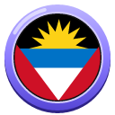 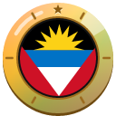

1. [Photograph the whole St. John's Cathedral with its two towers, in daylight.](https://cogvivo.com/en/challenge/land-ag-1)
2. [Take a selfie on Fort James Beach with the sea behind you.](https://cogvivo.com/en/challenge/land-ag-2)
3. [Photograph a place outside St. John's. Choose one from the list.](https://cogvivo.com/en/challenge/land-ag-3)
4. [Film yourself tasting fungee and pepperpot, or ducana.](https://cogvivo.com/en/challenge/land-ag-4)
5. [Film yourself playing a game of warri, the traditional board game.](https://cogvivo.com/en/challenge/land-ag-5)

**[▶ Open Antigua and Barbuda on Cogvivo](https://cogvivo.com/en/country/AG)**

## Argentina

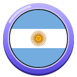 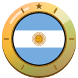

1. [Photograph the whole Obelisco in daylight.](https://cogvivo.com/en/challenge/land-ar-1)
2. [Take a selfie in Caminito, the colourful street in La Boca.](https://cogvivo.com/en/challenge/land-ar-2)
3. [Photograph a natural wonder outside Buenos Aires. Choose one from the list.](https://cogvivo.com/en/challenge/land-ar-3)
4. [Film yourself tasting an empanada with beef or with humita.](https://cogvivo.com/en/challenge/land-ar-4)
5. [Take a short tango class and film yourself dancing.](https://cogvivo.com/en/challenge/land-ar-5)

**[▶ Open Argentina on Cogvivo](https://cogvivo.com/en/country/AR)**

## Bahamas

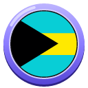 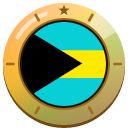

1. [Photograph the whole Queen's Staircase from below, in daylight.](https://cogvivo.com/en/challenge/land-bs-1)
2. [Take a selfie on Cable Beach with the sea behind you.](https://cogvivo.com/en/challenge/land-bs-2)
3. [Photograph a place on an island other than Nassau. Choose one from the list.](https://cogvivo.com/en/challenge/land-bs-3)
4. [Film yourself tasting conch salad or johnnycake.](https://cogvivo.com/en/challenge/land-bs-4)
5. [Film yourself playing a cowbell to Junkanoo music.](https://cogvivo.com/en/challenge/land-bs-5)

**[▶ Open Bahamas on Cogvivo](https://cogvivo.com/en/country/BS)**

## Barbados

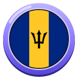 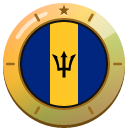

1. [Photograph the whole St. Michael's Cathedral in daylight.](https://cogvivo.com/en/challenge/land-bb-1)
2. [Take a selfie on the Chamberlain Bridge with the harbour behind you.](https://cogvivo.com/en/challenge/land-bb-2)
3. [Photograph a place outside Bridgetown. Choose one from the list.](https://cogvivo.com/en/challenge/land-bb-3)
4. [Film yourself tasting cou-cou and flying fish, or macaroni pie.](https://cogvivo.com/en/challenge/land-bb-4)
5. [Film yourself hitting or bowling a cricket ball on the beach.](https://cogvivo.com/en/challenge/land-bb-5)

**[▶ Open Barbados on Cogvivo](https://cogvivo.com/en/country/BB)**

## Belize

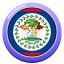 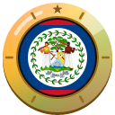

1. [Photograph the Swing Bridge over Haulover Creek in daylight.](https://cogvivo.com/en/challenge/land-bz-1)
2. [Take a selfie in front of St. John's Cathedral.](https://cogvivo.com/en/challenge/land-bz-2)
3. [Photograph a Maya temple outside Belize City. Choose one from the list.](https://cogvivo.com/en/challenge/land-bz-3)
4. [Film yourself tasting rice and beans with stew chicken, or fry jacks.](https://cogvivo.com/en/challenge/land-bz-4)
5. [Take a Garifuna drumming lesson and film yourself drumming.](https://cogvivo.com/en/challenge/land-bz-5)

**[▶ Open Belize on Cogvivo](https://cogvivo.com/en/country/BZ)**

## Bolivia

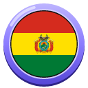 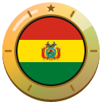

1. [Photograph the whole Basilica of San Francisco in daylight.](https://cogvivo.com/en/challenge/land-bo-1)
2. [Take a selfie in the Mi Teleférico cable car with La Paz behind you.](https://cogvivo.com/en/challenge/land-bo-2)
3. [Photograph a place outside La Paz. Choose one from the list.](https://cogvivo.com/en/challenge/land-bo-3)
4. [Film yourself tasting a salteña, or api with a pastel.](https://cogvivo.com/en/challenge/land-bo-4)
5. [Film yourself. Say hello and order something in Spanish.](https://cogvivo.com/en/challenge/land-bo-5)

**[▶ Open Bolivia on Cogvivo](https://cogvivo.com/en/country/BO)**

## Brazil

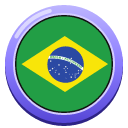 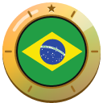

1. [Photograph the whole Christ the Redeemer statue in daylight.](https://cogvivo.com/en/challenge/land-br-1)
2. [Take a selfie on Sugarloaf Mountain with Rio behind you.](https://cogvivo.com/en/challenge/land-br-2)
3. [Photograph a place outside Rio. Choose one from the list.](https://cogvivo.com/en/challenge/land-br-3)
4. [Film yourself tasting feijoada or pão de queijo.](https://cogvivo.com/en/challenge/land-br-4)
5. [Film yourself. Say hello and order something in Portuguese: olá, obrigado.](https://cogvivo.com/en/challenge/land-br-5)

**[▶ Open Brazil on Cogvivo](https://cogvivo.com/en/country/BR)**

## Canada

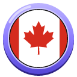 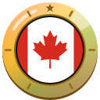

1. [Photograph the whole CN Tower in daylight.](https://cogvivo.com/en/challenge/land-ca-1)
2. [Take a selfie at the Toronto sign: Nathan Phillips Square.](https://cogvivo.com/en/challenge/land-ca-2)
3. [Photograph a famous place outside Toronto. Choose one from the list.](https://cogvivo.com/en/challenge/land-ca-3)
4. [Film yourself tasting poutine or a butter tart.](https://cogvivo.com/en/challenge/land-ca-4)
5. [Film yourself skating on an outdoor rink or paddling a canoe on a lake.](https://cogvivo.com/en/challenge/land-ca-5)

**[▶ Open Canada on Cogvivo](https://cogvivo.com/en/country/CA)**

## Chile

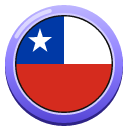 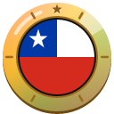

1. [Take a selfie on Cerro San Cristóbal with Santiago behind you.](https://cogvivo.com/en/challenge/land-cl-1)
2. [Photograph the whole cathedral on the Plaza de Armas in daylight.](https://cogvivo.com/en/challenge/land-cl-2)
3. [Photograph a place outside Santiago. Choose one from the list.](https://cogvivo.com/en/challenge/land-cl-3)
4. [Film yourself tasting an empanada de pino or humitas.](https://cogvivo.com/en/challenge/land-cl-4)
5. [Film yourself. Say hello and order something in Spanish.](https://cogvivo.com/en/challenge/land-cl-5)

**[▶ Open Chile on Cogvivo](https://cogvivo.com/en/country/CL)**

## Colombia

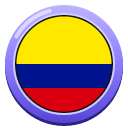 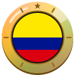

1. [Take a selfie on Monserrate with Bogotá behind you.](https://cogvivo.com/en/challenge/land-co-1)
2. [Photograph the cathedral on Plaza de Bolívar in daylight.](https://cogvivo.com/en/challenge/land-co-2)
3. [Photograph a place outside Bogotá. Choose one from the list.](https://cogvivo.com/en/challenge/land-co-3)
4. [Film yourself tasting ajiaco or an arepa with cheese.](https://cogvivo.com/en/challenge/land-co-4)
5. [Film yourself. Say hello and order something in Spanish.](https://cogvivo.com/en/challenge/land-co-5)

**[▶ Open Colombia on Cogvivo](https://cogvivo.com/en/country/CO)**

## Costa Rica

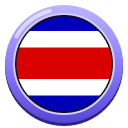 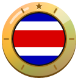

1. [Photograph the whole Teatro Nacional in daylight.](https://cogvivo.com/en/challenge/land-cr-1)
2. [Take a selfie in front of the Metropolitan Cathedral of San José.](https://cogvivo.com/en/challenge/land-cr-2)
3. [Photograph a natural wonder outside San José. Choose one from the list.](https://cogvivo.com/en/challenge/land-cr-3)
4. [Film yourself tasting gallo pinto or a casado.](https://cogvivo.com/en/challenge/land-cr-4)
5. [Film yourself. Say hello and thank you in Spanish, with 'pura vida'.](https://cogvivo.com/en/challenge/land-cr-5)

**[▶ Open Costa Rica on Cogvivo](https://cogvivo.com/en/country/CR)**

## Cuba

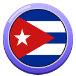 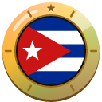

1. [Photograph Morro Castle from the Malecón, in daylight.](https://cogvivo.com/en/challenge/land-cu-1)
2. [Take a selfie on Plaza de la Catedral with the cathedral behind you.](https://cogvivo.com/en/challenge/land-cu-2)
3. [Photograph a place outside Havana. Choose one from the list.](https://cogvivo.com/en/challenge/land-cu-3)
4. [Film yourself tasting ropa vieja or moros y cristianos.](https://cogvivo.com/en/challenge/land-cu-4)
5. [Film yourself. Say hello and order something in Spanish.](https://cogvivo.com/en/challenge/land-cu-5)

**[▶ Open Cuba on Cogvivo](https://cogvivo.com/en/country/CU)**

## Dominica

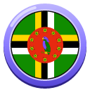 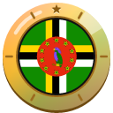

1. [Photograph the whole Roseau Cathedral in daylight.](https://cogvivo.com/en/challenge/land-dm-1)
2. [Take a selfie in the Roseau Botanic Gardens.](https://cogvivo.com/en/challenge/land-dm-2)
3. [Photograph a natural wonder outside Roseau. Choose one from the list.](https://cogvivo.com/en/challenge/land-dm-3)
4. [Film yourself tasting callaloo soup, or bakes with saltfish.](https://cogvivo.com/en/challenge/land-dm-4)
5. [Film yourself. Say hello and thank you in Kwéyòl: bonjou, mèsi.](https://cogvivo.com/en/challenge/land-dm-5)

**[▶ Open Dominica on Cogvivo](https://cogvivo.com/en/country/DM)**

## Dominican Republic

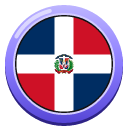 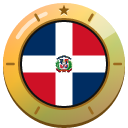

1. [Photograph the whole Cathedral of Santa María la Menor in daylight.](https://cogvivo.com/en/challenge/land-do-1)
2. [Take a selfie in front of the Alcázar de Colón.](https://cogvivo.com/en/challenge/land-do-2)
3. [Photograph a place outside Santo Domingo. Choose one from the list.](https://cogvivo.com/en/challenge/land-do-3)
4. [Film yourself tasting la bandera or mangú.](https://cogvivo.com/en/challenge/land-do-4)
5. [Film yourself. Say hello and order something in Spanish.](https://cogvivo.com/en/challenge/land-do-5)

**[▶ Open Dominican Republic on Cogvivo](https://cogvivo.com/en/country/DO)**

## Ecuador

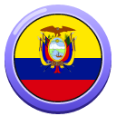 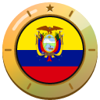

1. [Photograph the whole Basílica del Voto Nacional in daylight.](https://cogvivo.com/en/challenge/land-ec-1)
2. [Take a selfie at the Mitad del Mundo monument on the equator.](https://cogvivo.com/en/challenge/land-ec-2)
3. [Photograph a natural wonder outside Quito. Choose one from the list.](https://cogvivo.com/en/challenge/land-ec-3)
4. [Film yourself tasting locro de papa or encebollado.](https://cogvivo.com/en/challenge/land-ec-4)
5. [Film yourself. Say hello and order something in Spanish.](https://cogvivo.com/en/challenge/land-ec-5)

**[▶ Open Ecuador on Cogvivo](https://cogvivo.com/en/country/EC)**

## El Salvador

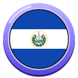 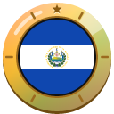

1. [Photograph the whole Monument to the Divine Savior of the World in daylight.](https://cogvivo.com/en/challenge/land-sv-1)
2. [Take a selfie in front of the Metropolitan Cathedral of San Salvador.](https://cogvivo.com/en/challenge/land-sv-2)
3. [Photograph a place outside San Salvador. Choose one from the list.](https://cogvivo.com/en/challenge/land-sv-3)
4. [Film yourself tasting pupusas with beans and cheese, or with loroco.](https://cogvivo.com/en/challenge/land-sv-4)
5. [Film yourself. Say hello and order something in Spanish.](https://cogvivo.com/en/challenge/land-sv-5)

**[▶ Open El Salvador on Cogvivo](https://cogvivo.com/en/country/SV)**

## Grenada

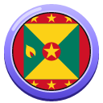 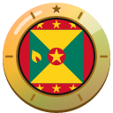

1. [Photograph the harbour of St. George's in daylight: The Carenage.](https://cogvivo.com/en/challenge/land-gd-1)
2. [Take a selfie on Grand Anse Beach with the sea behind you.](https://cogvivo.com/en/challenge/land-gd-2)
3. [Photograph a natural wonder outside St. George's. Choose one from the list.](https://cogvivo.com/en/challenge/land-gd-3)
4. [Film yourself tasting oil down or nutmeg ice cream.](https://cogvivo.com/en/challenge/land-gd-4)
5. [Film yourself at a spice market holding a whole nutmeg.](https://cogvivo.com/en/challenge/land-gd-5)

**[▶ Open Grenada on Cogvivo](https://cogvivo.com/en/country/GD)**

## Guatemala

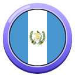 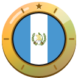

1. [Photograph the Santa Catalina Arch with Volcán de Agua behind it, in daylight.](https://cogvivo.com/en/challenge/land-gt-1)
2. [Take a selfie in front of the yellow church: Iglesia de La Merced.](https://cogvivo.com/en/challenge/land-gt-2)
3. [Photograph a place outside Antigua. Choose one from the list.](https://cogvivo.com/en/challenge/land-gt-3)
4. [Film yourself tasting pepián or rellenitos de plátano.](https://cogvivo.com/en/challenge/land-gt-4)
5. [Film yourself. Say hello and order something in Spanish.](https://cogvivo.com/en/challenge/land-gt-5)

**[▶ Open Guatemala on Cogvivo](https://cogvivo.com/en/country/GT)**

## Guyana

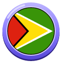 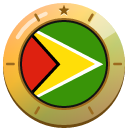

1. [Photograph the whole wooden St. George's Cathedral in daylight.](https://cogvivo.com/en/challenge/land-gy-1)
2. [Photograph the clock tower of Stabroek Market in daylight.](https://cogvivo.com/en/challenge/land-gy-2)
3. [Photograph a place outside Georgetown. Choose one from the list.](https://cogvivo.com/en/challenge/land-gy-3)
4. [Film yourself tasting pepperpot, or roti with vegetable curry.](https://cogvivo.com/en/challenge/land-gy-4)
5. [Film yourself in the stands at a cricket match, or bowling a ball yourself.](https://cogvivo.com/en/challenge/land-gy-5)

**[▶ Open Guyana on Cogvivo](https://cogvivo.com/en/country/GY)**

## Haiti

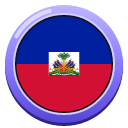 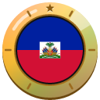

1. [Photograph the whole Cap-Haïtien Cathedral in daylight.](https://cogvivo.com/en/challenge/land-ht-1)
2. [Take a selfie at the ruins of Sans-Souci Palace.](https://cogvivo.com/en/challenge/land-ht-2)
3. [Photograph a place outside Cap-Haïtien. Choose one from the list.](https://cogvivo.com/en/challenge/land-ht-3)
4. [Film yourself tasting diri ak djon djon or soup joumou.](https://cogvivo.com/en/challenge/land-ht-4)
5. [Film yourself. Say 'bonjou' and order something in Haitian Creole.](https://cogvivo.com/en/challenge/land-ht-5)

**[▶ Open Haiti on Cogvivo](https://cogvivo.com/en/country/HT)**

## Honduras

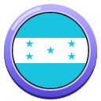 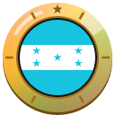

1. [Photograph the whole Cristo del Picacho statue in daylight.](https://cogvivo.com/en/challenge/land-hn-1)
2. [Take a selfie in front of Tegucigalpa Cathedral.](https://cogvivo.com/en/challenge/land-hn-2)
3. [Photograph a place outside Tegucigalpa. Choose one from the list.](https://cogvivo.com/en/challenge/land-hn-3)
4. [Film yourself tasting a baleada or sopa de caracol.](https://cogvivo.com/en/challenge/land-hn-4)
5. [Film yourself. Say hello and order something in Spanish.](https://cogvivo.com/en/challenge/land-hn-5)

**[▶ Open Honduras on Cogvivo](https://cogvivo.com/en/country/HN)**

## Jamaica

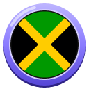 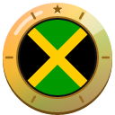

1. [Take a selfie on Doctor's Cave Beach with the sea behind you.](https://cogvivo.com/en/challenge/land-jm-1)
2. [Photograph the whole St. James Parish Church in daylight.](https://cogvivo.com/en/challenge/land-jm-2)
3. [Photograph a place outside Montego Bay. Choose one from the list.](https://cogvivo.com/en/challenge/land-jm-3)
4. [Film yourself tasting jerk chicken or a vegetarian ital stew.](https://cogvivo.com/en/challenge/land-jm-4)
5. [Take a reggae or dancehall dance class and film yourself dancing.](https://cogvivo.com/en/challenge/land-jm-5)

**[▶ Open Jamaica on Cogvivo](https://cogvivo.com/en/country/JM)**

## Mexico

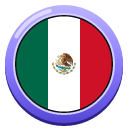 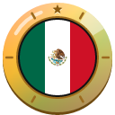

1. [Photograph the whole Palacio de Bellas Artes in daylight.](https://cogvivo.com/en/challenge/land-mx-1)
2. [Take a selfie with the Angel of Independence behind you.](https://cogvivo.com/en/challenge/land-mx-2)
3. [Photograph a monument outside Mexico City. Choose one from the list.](https://cogvivo.com/en/challenge/land-mx-3)
4. [Film yourself tasting tacos al pastor or vegetarian chilaquiles.](https://cogvivo.com/en/challenge/land-mx-4)
5. [Film yourself. Say hello and order something in Spanish.](https://cogvivo.com/en/challenge/land-mx-5)

**[▶ Open Mexico on Cogvivo](https://cogvivo.com/en/country/MX)**

## Nicaragua

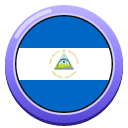 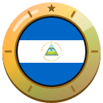

1. [Photograph the whole yellow Granada Cathedral in daylight.](https://cogvivo.com/en/challenge/land-ni-1)
2. [Take a selfie on Calle La Calzada with the cathedral behind you.](https://cogvivo.com/en/challenge/land-ni-2)
3. [Photograph a place outside Granada. Choose one from the list.](https://cogvivo.com/en/challenge/land-ni-3)
4. [Film yourself tasting gallo pinto or quesillo.](https://cogvivo.com/en/challenge/land-ni-4)
5. [Film yourself. Say hello and order something in Spanish.](https://cogvivo.com/en/challenge/land-ni-5)

**[▶ Open Nicaragua on Cogvivo](https://cogvivo.com/en/country/NI)**

## Panama

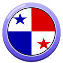 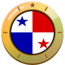

1. [Photograph a ship in the Miraflores Locks of the Panama Canal.](https://cogvivo.com/en/challenge/land-pa-1)
2. [Take a selfie in Casco Viejo with the Panama City skyline behind you.](https://cogvivo.com/en/challenge/land-pa-2)
3. [Photograph a place outside Panama City. Choose one from the list.](https://cogvivo.com/en/challenge/land-pa-3)
4. [Film yourself tasting sancocho or patacones.](https://cogvivo.com/en/challenge/land-pa-4)
5. [Film yourself. Say hello and order something in Spanish.](https://cogvivo.com/en/challenge/land-pa-5)

**[▶ Open Panama on Cogvivo](https://cogvivo.com/en/country/PA)**

## Paraguay

 

1. [Photograph the whole Asunción Cathedral in daylight.](https://cogvivo.com/en/challenge/land-py-1)
2. [Take a selfie in front of the Casa de la Independencia.](https://cogvivo.com/en/challenge/land-py-2)
3. [Photograph a place outside Asunción. Choose one from the list.](https://cogvivo.com/en/challenge/land-py-3)
4. [Film yourself drinking tereré and tasting chipa or sopa paraguaya.](https://cogvivo.com/en/challenge/land-py-4)
5. [Film yourself. Say hello and thank you in Guaraní: mba'éichapa, aguyje.](https://cogvivo.com/en/challenge/land-py-5)

**[▶ Open Paraguay on Cogvivo](https://cogvivo.com/en/country/PY)**

## Peru

 

1. [Photograph the whole cathedral on Cusco's Plaza de Armas, in daylight.](https://cogvivo.com/en/challenge/land-pe-1)
2. [Take a selfie at the great stone walls of Sacsayhuamán.](https://cogvivo.com/en/challenge/land-pe-2)
3. [Photograph a place outside Cusco. Choose one from the list.](https://cogvivo.com/en/challenge/land-pe-3)
4. [Film yourself tasting ceviche or papa a la huancaína.](https://cogvivo.com/en/challenge/land-pe-4)
5. [Film yourself. Say hello and order something in Spanish.](https://cogvivo.com/en/challenge/land-pe-5)

**[▶ Open Peru on Cogvivo](https://cogvivo.com/en/country/PE)**

## Saint Kitts and Nevis

 

1. [Photograph the clock on The Circus in daylight.](https://cogvivo.com/en/challenge/land-kn-1)
2. [Take a selfie on Timothy Hill with two seas behind you.](https://cogvivo.com/en/challenge/land-kn-2)
3. [Photograph a place outside Basseterre. Choose one from the list.](https://cogvivo.com/en/challenge/land-kn-3)
4. [Film yourself tasting saltfish with spicy plantains, or coconut dumplings.](https://cogvivo.com/en/challenge/land-kn-4)
5. [Film yourself playing a game of dominoes.](https://cogvivo.com/en/challenge/land-kn-5)

**[▶ Open Saint Kitts and Nevis on Cogvivo](https://cogvivo.com/en/country/KN)**

## Saint Lucia

 

1. [Photograph the whole cathedral of Castries in daylight.](https://cogvivo.com/en/challenge/land-lc-1)
2. [Take a selfie on Pigeon Island with Rodney Bay behind you.](https://cogvivo.com/en/challenge/land-lc-2)
3. [Photograph a place outside Castries. Choose one from the list.](https://cogvivo.com/en/challenge/land-lc-3)
4. [Film yourself tasting green fig and saltfish, or cocoa tea.](https://cogvivo.com/en/challenge/land-lc-4)
5. [Film yourself. Say hello and thank you in Kwéyòl: bonjou, mèsi.](https://cogvivo.com/en/challenge/land-lc-5)

**[▶ Open Saint Lucia on Cogvivo](https://cogvivo.com/en/country/LC)**

## Saint Vincent and the Grenadines

 

1. [Photograph the whole St. Mary's Cathedral in daylight.](https://cogvivo.com/en/challenge/land-vc-1)
2. [Take a selfie in the Kingstown Botanic Gardens.](https://cogvivo.com/en/challenge/land-vc-2)
3. [Photograph a place outside Kingstown. Choose one from the list.](https://cogvivo.com/en/challenge/land-vc-3)
4. [Film yourself tasting roasted breadfruit with jackfish, or callaloo soup.](https://cogvivo.com/en/challenge/land-vc-4)
5. [Film yourself buying fruit at the market and saying thank you.](https://cogvivo.com/en/challenge/land-vc-5)

**[▶ Open Saint Vincent and the Grenadines on Cogvivo](https://cogvivo.com/en/country/VC)**

## Suriname

 

1. [Photograph the whole wooden Saints Peter and Paul Cathedral in daylight.](https://cogvivo.com/en/challenge/land-sr-1)
2. [Photograph the mosque and the synagogue side by side on Keizerstraat.](https://cogvivo.com/en/challenge/land-sr-2)
3. [Photograph a place outside Paramaribo. Choose one from the list.](https://cogvivo.com/en/challenge/land-sr-3)
4. [Film yourself tasting pom, or roti with vegetables.](https://cogvivo.com/en/challenge/land-sr-4)
5. [Film yourself. Say hello and thank you in Sranan Tongo: fa waka, grantangi.](https://cogvivo.com/en/challenge/land-sr-5)

**[▶ Open Suriname on Cogvivo](https://cogvivo.com/en/country/SR)**

## Trinidad and Tobago

 

1. [Photograph the whole Stollmeyer's Castle in daylight.](https://cogvivo.com/en/challenge/land-tt-1)
2. [Take a selfie at Fort George with Port of Spain behind you.](https://cogvivo.com/en/challenge/land-tt-2)
3. [Photograph a place outside Port of Spain. Choose one from the list.](https://cogvivo.com/en/challenge/land-tt-3)
4. [Film yourself tasting doubles or bake and shark.](https://cogvivo.com/en/challenge/land-tt-4)
5. [Film yourself playing a few notes on a steelpan.](https://cogvivo.com/en/challenge/land-tt-5)

**[▶ Open Trinidad and Tobago on Cogvivo](https://cogvivo.com/en/country/TT)**

## United States

 

1. [Photograph the whole Statue of Liberty in daylight, from the ferry or Battery Park.](https://cogvivo.com/en/challenge/land-us-1)
2. [Take a selfie on the Brooklyn Bridge with the Manhattan skyline behind you.](https://cogvivo.com/en/challenge/land-us-2)
3. [Photograph a famous place outside New York. Choose one from the list.](https://cogvivo.com/en/challenge/land-us-3)
4. [Film yourself tasting a New York pizza slice or a bagel.](https://cogvivo.com/en/challenge/land-us-4)
5. [Film yourself in the stands at a baseball or basketball game.](https://cogvivo.com/en/challenge/land-us-5)

**[▶ Open United States on Cogvivo](https://cogvivo.com/en/country/US)**

## Uruguay

 

1. [Photograph the whole Palacio Salvo in daylight.](https://cogvivo.com/en/challenge/land-uy-1)
2. [Take a selfie at the big MONTEVIDEO letters on the Rambla.](https://cogvivo.com/en/challenge/land-uy-2)
3. [Photograph a place outside Montevideo. Choose one from the list.](https://cogvivo.com/en/challenge/land-uy-3)
4. [Film yourself tasting a chivito or torta frita.](https://cogvivo.com/en/challenge/land-uy-4)
5. [Film yourself drinking mate the Uruguayan way.](https://cogvivo.com/en/challenge/land-uy-5)

**[▶ Open Uruguay on Cogvivo](https://cogvivo.com/en/country/UY)**

## Venezuela

 

1. [Photograph the University City of Caracas in daylight: the square by the Aula Magna.](https://cogvivo.com/en/challenge/land-ve-1)
2. [Take a selfie on El Ávila with Caracas behind you.](https://cogvivo.com/en/challenge/land-ve-2)
3. [Photograph a natural wonder outside Caracas. Choose one from the list.](https://cogvivo.com/en/challenge/land-ve-3)
4. [Film yourself tasting an arepa with black beans and cheese, or tequeños.](https://cogvivo.com/en/challenge/land-ve-4)
5. [Film yourself. Say hello and order something in Spanish.](https://cogvivo.com/en/challenge/land-ve-5)

**[▶ Open Venezuela on Cogvivo](https://cogvivo.com/en/country/VE)**

---

© 2026 Tim Wijnands. Cogvivo™, its texts, challenges and badges are protected: public to view and to help with, not to copy or reuse. See [LICENSE](../../LICENSE).

*This page is generated automatically from the app. Changes made here by hand are overwritten.*
