# Country challenges: East Asia and Oceania

[← All continents](README.md)

## Australia

 

1. [Photograph the whole Sydney Opera House in daylight.](https://cogvivo.com/en/challenge/land-au-1)
2. [Take a selfie on Bondi Beach or with the Harbour Bridge behind you.](https://cogvivo.com/en/challenge/land-au-2)
3. [Photograph a famous place outside Sydney. Choose one from the list.](https://cogvivo.com/en/challenge/land-au-3)
4. [Taste a meat pie or a lamington. Film your reaction.](https://cogvivo.com/en/challenge/land-au-4)
5. [Learn a word in an Aboriginal language from an Aboriginal guide or centre. Film yourself.](https://cogvivo.com/en/challenge/land-au-5)

**[▶ Open Australia on Cogvivo](https://cogvivo.com/en/country/AU)**

## Brunei

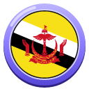 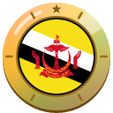

1. [Photograph the Sultan Omar Ali Saifuddien Mosque from outside in daylight.](https://cogvivo.com/en/challenge/land-bn-1)
2. [Take a selfie with the water village Kampong Ayer behind you.](https://cogvivo.com/en/challenge/land-bn-2)
3. [Photograph a famous place outside the centre. Choose one from the list.](https://cogvivo.com/en/challenge/land-bn-3)
4. [Taste ambuyat or nasi katok. Film your reaction.](https://cogvivo.com/en/challenge/land-bn-4)
5. [Film yourself. Say 'terima kasih' when you order something in Malay.](https://cogvivo.com/en/challenge/land-bn-5)

**[▶ Open Brunei on Cogvivo](https://cogvivo.com/en/country/BN)**

## Cambodia

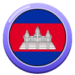 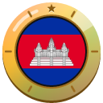

1. [Photograph the whole Angkor Wat in daylight, from the pond in front.](https://cogvivo.com/en/challenge/land-kh-1)
2. [Take a selfie with the stone faces of Bayon Temple.](https://cogvivo.com/en/challenge/land-kh-2)
3. [Photograph a monument outside Siem Reap. Choose one from the list.](https://cogvivo.com/en/challenge/land-kh-3)
4. [Taste amok or nom banh chok (Khmer noodles). Film your reaction.](https://cogvivo.com/en/challenge/land-kh-4)
5. [Film yourself. Say 'chum reap suor' and order something in Khmer.](https://cogvivo.com/en/challenge/land-kh-5)

**[▶ Open Cambodia on Cogvivo](https://cogvivo.com/en/country/KH)**

## China

 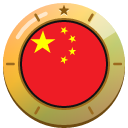

1. [Photograph the whole Hall of Prayer for Good Harvests in daylight: Temple of Heaven.](https://cogvivo.com/en/challenge/land-cn-1)
2. [Take a selfie at the Forbidden City: the Palace Museum in Beijing.](https://cogvivo.com/en/challenge/land-cn-2)
3. [Photograph the Great Wall or another monument outside Beijing. Choose one from the list.](https://cogvivo.com/en/challenge/land-cn-3)
4. [Taste Peking duck or Lanzhou beef noodles. Film your reaction.](https://cogvivo.com/en/challenge/land-cn-4)
5. [Film yourself. Say 'nǐ hǎo' and order something in Mandarin.](https://cogvivo.com/en/challenge/land-cn-5)

**[▶ Open China on Cogvivo](https://cogvivo.com/en/country/CN)**

## Fiji

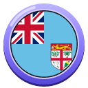 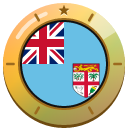

1. [Photograph the Sri Siva Subramaniya Temple from outside in daylight.](https://cogvivo.com/en/challenge/land-fj-1)
2. [Take a selfie in the Garden of the Sleeping Giant.](https://cogvivo.com/en/challenge/land-fj-2)
3. [Photograph a famous place outside Nadi. Choose one from the list.](https://cogvivo.com/en/challenge/land-fj-3)
4. [Taste kokoda (fish in coconut) or roti with vegetable curry. Film your reaction.](https://cogvivo.com/en/challenge/land-fj-4)
5. [Film yourself. Say 'bula' and 'vinaka' when you order something in Fijian.](https://cogvivo.com/en/challenge/land-fj-5)

**[▶ Open Fiji on Cogvivo](https://cogvivo.com/en/country/FJ)**

## Indonesia

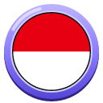 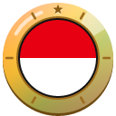

1. [Photograph the sea temple Tanah Lot in daylight.](https://cogvivo.com/en/challenge/land-id-1)
2. [Take a selfie at the Tegallalang Rice Terraces or Uluwatu Temple.](https://cogvivo.com/en/challenge/land-id-2)
3. [Photograph a famous place on Java. Choose one from the list.](https://cogvivo.com/en/challenge/land-id-3)
4. [Taste nasi goreng or gado-gado. Film your reaction.](https://cogvivo.com/en/challenge/land-id-4)
5. [Film yourself. Order something and say 'terima kasih' in Indonesian.](https://cogvivo.com/en/challenge/land-id-5)

**[▶ Open Indonesia on Cogvivo](https://cogvivo.com/en/country/ID)**

## Japan

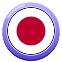 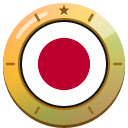

1. [Photograph the Kaminarimon Gate of Sensō-ji Temple in daylight.](https://cogvivo.com/en/challenge/land-jp-1)
2. [Take a selfie with Tokyo Skytree or Tokyo Tower behind you.](https://cogvivo.com/en/challenge/land-jp-2)
3. [Photograph a famous place outside Tokyo. Choose one from the list.](https://cogvivo.com/en/challenge/land-jp-3)
4. [Taste ramen or vegetarian sushi. Film your reaction.](https://cogvivo.com/en/challenge/land-jp-4)
5. [Film yourself. Say 'konnichiwa' and order something in Japanese.](https://cogvivo.com/en/challenge/land-jp-5)

**[▶ Open Japan on Cogvivo](https://cogvivo.com/en/country/JP)**

## Kiribati

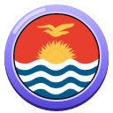 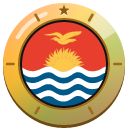

1. [Photograph a traditional maneaba (meeting house) from outside. Ask permission first.](https://cogvivo.com/en/challenge/land-ki-1)
2. [Take a selfie by the Tarawa lagoon.](https://cogvivo.com/en/challenge/land-ki-2)
3. [Photograph an atoll outside South Tarawa. Choose one from the list.](https://cogvivo.com/en/challenge/land-ki-3)
4. [Taste fish with coconut or breadfruit. Film your reaction.](https://cogvivo.com/en/challenge/land-ki-4)
5. [Film yourself. Say 'mauri' (hello) and 'ko rabwa' (thank you) in Gilbertese.](https://cogvivo.com/en/challenge/land-ki-5)

**[▶ Open Kiribati on Cogvivo](https://cogvivo.com/en/country/KI)**

## Laos

 

1. [Photograph Wat Xieng Thong temple from outside in daylight.](https://cogvivo.com/en/challenge/land-la-1)
2. [Take a selfie on Mount Phousi with Luang Prabang behind you.](https://cogvivo.com/en/challenge/land-la-2)
3. [Photograph a monument outside Luang Prabang. Choose one from the list.](https://cogvivo.com/en/challenge/land-la-3)
4. [Taste laap or sticky rice (khao niao). Film your reaction.](https://cogvivo.com/en/challenge/land-la-4)
5. [Film yourself. Say 'sabaidee' and order something in Lao.](https://cogvivo.com/en/challenge/land-la-5)

**[▶ Open Laos on Cogvivo](https://cogvivo.com/en/country/LA)**

## Malaysia

 

1. [Photograph the whole Petronas Twin Towers in daylight.](https://cogvivo.com/en/challenge/land-my-1)
2. [Take a selfie at Batu Caves with the golden statue behind you.](https://cogvivo.com/en/challenge/land-my-2)
3. [Photograph a monument outside Kuala Lumpur. Choose one from the list.](https://cogvivo.com/en/challenge/land-my-3)
4. [Taste nasi lemak or roti canai. Film your reaction.](https://cogvivo.com/en/challenge/land-my-4)
5. [Film yourself. Say 'apa khabar' and order something in Malay.](https://cogvivo.com/en/challenge/land-my-5)

**[▶ Open Malaysia on Cogvivo](https://cogvivo.com/en/country/MY)**

## Marshall Islands

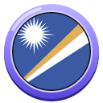 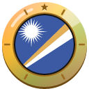

1. [Photograph the Alele Museum in Majuro from outside in daylight.](https://cogvivo.com/en/challenge/land-mh-1)
2. [Take a selfie on Laura Beach, at the west end of Majuro.](https://cogvivo.com/en/challenge/land-mh-2)
3. [Photograph an island outside Majuro town. Choose one from the list.](https://cogvivo.com/en/challenge/land-mh-3)
4. [Taste breadfruit or pandanus. Film your reaction.](https://cogvivo.com/en/challenge/land-mh-4)
5. [Film yourself. Say 'iokwe' (hello) and 'kommool' (thank you) in Marshallese.](https://cogvivo.com/en/challenge/land-mh-5)

**[▶ Open Marshall Islands on Cogvivo](https://cogvivo.com/en/country/MH)**

## Micronesia

 

1. [Photograph the whole Sokehs Rock in daylight.](https://cogvivo.com/en/challenge/land-fm-1)
2. [Take a selfie at Kepirohi Waterfall.](https://cogvivo.com/en/challenge/land-fm-2)
3. [Photograph a monument outside Kolonia. Choose one from the list.](https://cogvivo.com/en/challenge/land-fm-3)
4. [Taste breadfruit or yams with coconut. Film your reaction.](https://cogvivo.com/en/challenge/land-fm-4)
5. [Film yourself. Say 'kaselehlie' (hello) and 'kalahngan' (thank you) in Pohnpeian.](https://cogvivo.com/en/challenge/land-fm-5)

**[▶ Open Micronesia on Cogvivo](https://cogvivo.com/en/country/FM)**

## Mongolia

 

1. [Photograph Gandan Monastery from outside in daylight.](https://cogvivo.com/en/challenge/land-mn-1)
2. [Take a selfie at the Winter Palace of the Bogd Khan.](https://cogvivo.com/en/challenge/land-mn-2)
3. [Photograph a monument outside Ulaanbaatar. Choose one from the list.](https://cogvivo.com/en/challenge/land-mn-3)
4. [Taste buuz (dumplings) or suutei tsai (milk tea). Film your reaction.](https://cogvivo.com/en/challenge/land-mn-4)
5. [Film yourself. Say 'sain baina uu' and order something in Mongolian.](https://cogvivo.com/en/challenge/land-mn-5)

**[▶ Open Mongolia on Cogvivo](https://cogvivo.com/en/country/MN)**

## Myanmar

 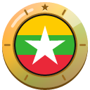

1. [Photograph the whole Shwedagon Pagoda in daylight.](https://cogvivo.com/en/challenge/land-mm-1)
2. [Take a selfie at Kandawgyi Lake with Karaweik Hall behind you.](https://cogvivo.com/en/challenge/land-mm-2)
3. [Photograph a monument outside Yangon. Choose one from the list.](https://cogvivo.com/en/challenge/land-mm-3)
4. [Taste mohinga (fish noodle soup) or tea leaf salad (lahpet thoke). Film your reaction.](https://cogvivo.com/en/challenge/land-mm-4)
5. [Film yourself. Say 'mingalaba' and order something in Burmese.](https://cogvivo.com/en/challenge/land-mm-5)

**[▶ Open Myanmar on Cogvivo](https://cogvivo.com/en/country/MM)**

## Nauru

 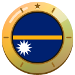

1. [Photograph the coral pinnacles on the Yaren coast in daylight.](https://cogvivo.com/en/challenge/land-nr-1)
2. [Take a selfie at Anibare Bay.](https://cogvivo.com/en/challenge/land-nr-2)
3. [Photograph a place inland. Choose one from the list.](https://cogvivo.com/en/challenge/land-nr-3)
4. [Taste fish with coconut or fresh coconut. Film your reaction.](https://cogvivo.com/en/challenge/land-nr-4)
5. [Film yourself. Say 'Ekamawir omo' (hello) in Nauruan.](https://cogvivo.com/en/challenge/land-nr-5)

**[▶ Open Nauru on Cogvivo](https://cogvivo.com/en/country/NR)**

## New Zealand

 

1. [Photograph the whole Sky Tower in daylight.](https://cogvivo.com/en/challenge/land-nz-1)
2. [Take a selfie on Maungawhau (Mount Eden) with Auckland behind you.](https://cogvivo.com/en/challenge/land-nz-2)
3. [Photograph a famous place outside Auckland. Choose one from the list.](https://cogvivo.com/en/challenge/land-nz-3)
4. [Taste a hāngī meal or pavlova. Film your reaction.](https://cogvivo.com/en/challenge/land-nz-4)
5. [Film yourself. Say 'kia ora' (hello in Māori) when you order something.](https://cogvivo.com/en/challenge/land-nz-5)

**[▶ Open New Zealand on Cogvivo](https://cogvivo.com/en/country/NZ)**

## North Korea

 

1. [Photograph the whole Ryugyong Hotel in Pyongyang in daylight.](https://cogvivo.com/en/challenge/land-kp-1)
2. [Take a selfie in Moranbong Park with the Taedong River behind you.](https://cogvivo.com/en/challenge/land-kp-2)
3. [Photograph a famous mountain outside Pyongyang. Choose one from the list.](https://cogvivo.com/en/challenge/land-kp-3)
4. [Taste Pyongyang naengmyeon (cold noodles) or kimchi. Film your reaction.](https://cogvivo.com/en/challenge/land-kp-4)
5. [Film yourself. Say 'annyeonghasimnikka' and order something in Korean.](https://cogvivo.com/en/challenge/land-kp-5)

**[▶ Open North Korea on Cogvivo](https://cogvivo.com/en/country/KP)**

## Palau

 

1. [Photograph the traditional bai (meeting house) at the Belau National Museum.](https://cogvivo.com/en/challenge/land-pw-1)
2. [Take a selfie during a boat trip through the Rock Islands.](https://cogvivo.com/en/challenge/land-pw-2)
3. [Photograph a famous place on Babeldaob. Choose one from the list.](https://cogvivo.com/en/challenge/land-pw-3)
4. [Taste taro with coconut or fresh fish. Film your reaction.](https://cogvivo.com/en/challenge/land-pw-4)
5. [Film yourself. Say 'alii' (hello) and 'sulang' (thank you) in Palauan.](https://cogvivo.com/en/challenge/land-pw-5)

**[▶ Open Palau on Cogvivo](https://cogvivo.com/en/country/PW)**

## Papua New Guinea

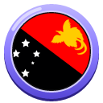 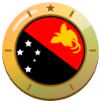

1. [Photograph the National Museum and Art Gallery from outside in daylight.](https://cogvivo.com/en/challenge/land-pg-1)
2. [Take a selfie in Port Moresby Nature Park.](https://cogvivo.com/en/challenge/land-pg-2)
3. [Photograph a famous place outside Port Moresby. Choose one from the list.](https://cogvivo.com/en/challenge/land-pg-3)
4. [Taste mumu (from the earth oven) or sago. Film your reaction.](https://cogvivo.com/en/challenge/land-pg-4)
5. [Film yourself. Say 'tenkyu' when you order something in Tok Pisin.](https://cogvivo.com/en/challenge/land-pg-5)

**[▶ Open Papua New Guinea on Cogvivo](https://cogvivo.com/en/country/PG)**

## Philippines

 

1. [Photograph San Agustin Church in Intramuros in daylight.](https://cogvivo.com/en/challenge/land-ph-1)
2. [Take a selfie at Manila Cathedral in Intramuros.](https://cogvivo.com/en/challenge/land-ph-2)
3. [Photograph a famous place outside Manila. Choose one from the list.](https://cogvivo.com/en/challenge/land-ph-3)
4. [Taste adobo or halo-halo. Film your reaction.](https://cogvivo.com/en/challenge/land-ph-4)
5. [Film yourself. Say 'kumusta' and order something in Filipino.](https://cogvivo.com/en/challenge/land-ph-5)

**[▶ Open Philippines on Cogvivo](https://cogvivo.com/en/country/PH)**

## Samoa

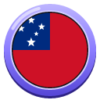 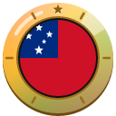

1. [Photograph the Immaculate Conception Cathedral in Apia in daylight.](https://cogvivo.com/en/challenge/land-ws-1)
2. [Take a selfie at the Robert Louis Stevenson Museum (Villa Vailima).](https://cogvivo.com/en/challenge/land-ws-2)
3. [Photograph a famous place outside Apia. Choose one from the list.](https://cogvivo.com/en/challenge/land-ws-3)
4. [Taste oka (fish in coconut) or palusami (taro leaves in coconut cream). Film your reaction.](https://cogvivo.com/en/challenge/land-ws-4)
5. [Film yourself. Say 'talofa' and 'fa'afetai' when you order something in Samoan.](https://cogvivo.com/en/challenge/land-ws-5)

**[▶ Open Samoa on Cogvivo](https://cogvivo.com/en/country/WS)**

## Singapore

 

1. [Photograph the whole Merlion statue in daylight, with Marina Bay behind it.](https://cogvivo.com/en/challenge/land-sg-1)
2. [Take a selfie at the Supertrees in Gardens by the Bay in daylight.](https://cogvivo.com/en/challenge/land-sg-2)
3. [Photograph a famous place outside the city centre. Choose one from the list.](https://cogvivo.com/en/challenge/land-sg-3)
4. [Taste chicken rice or roti prata at a hawker centre. Film only your plate.](https://cogvivo.com/en/challenge/land-sg-4)
5. [Film yourself. Say 'terima kasih' (thank you) in Malay, the national language.](https://cogvivo.com/en/challenge/land-sg-5)

**[▶ Open Singapore on Cogvivo](https://cogvivo.com/en/country/SG)**

## Solomon Islands

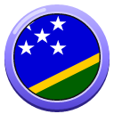 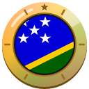

1. [Photograph Holy Cross Cathedral in Honiara from outside in daylight.](https://cogvivo.com/en/challenge/land-sb-1)
2. [Take a selfie at Mataniko Falls.](https://cogvivo.com/en/challenge/land-sb-2)
3. [Photograph a famous place outside Honiara. Choose one from the list.](https://cogvivo.com/en/challenge/land-sb-3)
4. [Taste fish in coconut milk or cassava pudding. Film your reaction.](https://cogvivo.com/en/challenge/land-sb-4)
5. [Film yourself. Say 'tanggio tumas' (thank you very much) when you order in Pijin.](https://cogvivo.com/en/challenge/land-sb-5)

**[▶ Open Solomon Islands on Cogvivo](https://cogvivo.com/en/country/SB)**

## South Korea

 

1. [Photograph the whole Geunjeongjeon Throne Hall of Gyeongbokgung Palace in daylight.](https://cogvivo.com/en/challenge/land-kr-1)
2. [Take a selfie on Namsan Mountain with N Seoul Tower behind you.](https://cogvivo.com/en/challenge/land-kr-2)
3. [Photograph a monument outside Seoul. Choose one from the list.](https://cogvivo.com/en/challenge/land-kr-3)
4. [Taste bibimbap or tteokbokki. Film your reaction.](https://cogvivo.com/en/challenge/land-kr-4)
5. [Film yourself. Say 'annyeonghaseyo' and order something in Korean.](https://cogvivo.com/en/challenge/land-kr-5)

**[▶ Open South Korea on Cogvivo](https://cogvivo.com/en/country/KR)**

## Taiwan

 

1. [Photograph Longshan Temple from outside in daylight.](https://cogvivo.com/en/challenge/land-tw-1)
2. [Take a selfie on Elephant Mountain (Xiangshan) with Taipei 101 behind you.](https://cogvivo.com/en/challenge/land-tw-2)
3. [Photograph a famous place outside Taipei. Choose one from the list.](https://cogvivo.com/en/challenge/land-tw-3)
4. [Taste Taiwanese beef noodle soup or bubble tea. Film your reaction.](https://cogvivo.com/en/challenge/land-tw-4)
5. [Film yourself. Order something at a night market and say 'xièxie' in Mandarin.](https://cogvivo.com/en/challenge/land-tw-5)

**[▶ Open Taiwan on Cogvivo](https://cogvivo.com/en/country/TW)**

## Thailand

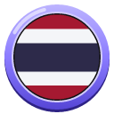 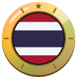

1. [Photograph the whole Wat Arun in daylight, from across the river.](https://cogvivo.com/en/challenge/land-th-1)
2. [Take a selfie on the Golden Mount (Wat Saket) with Bangkok behind you.](https://cogvivo.com/en/challenge/land-th-2)
3. [Photograph a monument outside Bangkok. Choose one from the list.](https://cogvivo.com/en/challenge/land-th-3)
4. [Taste pad thai or green curry. Film your reaction.](https://cogvivo.com/en/challenge/land-th-4)
5. [Film yourself. Say 'sawasdee' and order something in Thai.](https://cogvivo.com/en/challenge/land-th-5)

**[▶ Open Thailand on Cogvivo](https://cogvivo.com/en/country/TH)**

## Timor-Leste

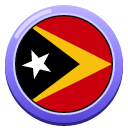 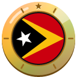

1. [Climb to the Cristo Rei statue and photograph the whole statue in daylight.](https://cogvivo.com/en/challenge/land-tl-1)
2. [Take a selfie on Areia Branca Beach.](https://cogvivo.com/en/challenge/land-tl-2)
3. [Photograph a famous place outside Dili. Choose one from the list.](https://cogvivo.com/en/challenge/land-tl-3)
4. [Taste batar daan (corn, beans and pumpkin) or grilled fish. Film your reaction.](https://cogvivo.com/en/challenge/land-tl-4)
5. [Film yourself. Say 'bondia' and order something in Tetum.](https://cogvivo.com/en/challenge/land-tl-5)

**[▶ Open Timor-Leste on Cogvivo](https://cogvivo.com/en/country/TL)**

## Tonga

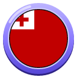 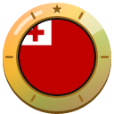

1. [Photograph the Centenary Church in Nuku'alofa from outside in daylight.](https://cogvivo.com/en/challenge/land-to-1)
2. [Take a selfie at the Mapu'a 'a Vaea blowholes.](https://cogvivo.com/en/challenge/land-to-2)
3. [Photograph a monument or cave outside Nuku'alofa. Choose one from the list.](https://cogvivo.com/en/challenge/land-to-3)
4. [Taste 'ota 'ika (fish in coconut) or lu (taro leaves in coconut cream). Film your reaction.](https://cogvivo.com/en/challenge/land-to-4)
5. [Film yourself. Say 'mālō e lelei' and 'mālō' when you order something in Tongan.](https://cogvivo.com/en/challenge/land-to-5)

**[▶ Open Tonga on Cogvivo](https://cogvivo.com/en/country/TO)**

## Tuvalu

 

1. [Buy a stamp at the Tuvalu Philatelic Bureau and photograph it.](https://cogvivo.com/en/challenge/land-tv-1)
2. [Take a selfie by the Funafuti lagoon.](https://cogvivo.com/en/challenge/land-tv-2)
3. [Photograph an islet outside the main island. Choose one from the list.](https://cogvivo.com/en/challenge/land-tv-3)
4. [Taste pulaka (swamp taro) or fish with coconut. Film your reaction.](https://cogvivo.com/en/challenge/land-tv-4)
5. [Film yourself. Say 'talofa' and 'fakafetai' in Tuvaluan.](https://cogvivo.com/en/challenge/land-tv-5)

**[▶ Open Tuvalu on Cogvivo](https://cogvivo.com/en/country/TV)**

## Vanuatu

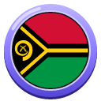 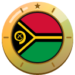

1. [Photograph the Mele Cascades waterfalls in daylight.](https://cogvivo.com/en/challenge/land-vu-1)
2. [Take a selfie at Hideaway Island, the island with the underwater post office.](https://cogvivo.com/en/challenge/land-vu-2)
3. [Photograph a famous place on another island. Choose one from the list.](https://cogvivo.com/en/challenge/land-vu-3)
4. [Taste lap lap or tuluk. Film your reaction.](https://cogvivo.com/en/challenge/land-vu-4)
5. [Film yourself. Say 'halo' and 'tankyu tumas' when you order something in Bislama.](https://cogvivo.com/en/challenge/land-vu-5)

**[▶ Open Vanuatu on Cogvivo](https://cogvivo.com/en/country/VU)**

## Vietnam

 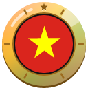

1. [Photograph the red Thê Húc Bridge at Hoàn Kiếm Lake in daylight.](https://cogvivo.com/en/challenge/land-vn-1)
2. [Take a selfie at the Temple of Literature.](https://cogvivo.com/en/challenge/land-vn-2)
3. [Photograph a famous place outside Hanoi. Choose one from the list.](https://cogvivo.com/en/challenge/land-vn-3)
4. [Taste phở bò or phở chay (vegetarian). Film your reaction.](https://cogvivo.com/en/challenge/land-vn-4)
5. [Film yourself. Say 'xin chào' and order something in Vietnamese.](https://cogvivo.com/en/challenge/land-vn-5)

**[▶ Open Vietnam on Cogvivo](https://cogvivo.com/en/country/VN)**

---

© 2026 Tim Wijnands. Cogvivo™, its texts, challenges and badges are protected: public to view and to help with, not to copy or reuse. See [LICENSE](../../LICENSE).

*This page is generated automatically from the app. Changes made here by hand are overwritten.*
