# Country challenges: Europe

[← All continents](README.md)

## Albania

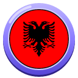 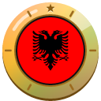

1. [Photograph the Et'hem Bey Mosque on Skanderbeg Square from outside.](https://cogvivo.com/en/challenge/land-al-1)
2. [Take a selfie with the Clock Tower of Tirana or Skanderbeg Square behind you.](https://cogvivo.com/en/challenge/land-al-2)
3. [Photograph a monument outside Tirana. Choose one from the list.](https://cogvivo.com/en/challenge/land-al-3)
4. [Taste spinach byrek or tavë kosi. Film your reaction.](https://cogvivo.com/en/challenge/land-al-4)
5. [Order something in Albanian: say 'Përshëndetje' and 'Faleminderit'. Film yourself.](https://cogvivo.com/en/challenge/land-al-5)

**[▶ Open Albania on Cogvivo](https://cogvivo.com/en/country/AL)**

## Andorra

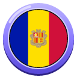 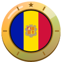

1. [Photograph the Romanesque church of Sant Esteve in Andorra la Vella.](https://cogvivo.com/en/challenge/land-ad-1)
2. [Take a selfie at Casa de la Vall or the Caldea spa building.](https://cogvivo.com/en/challenge/land-ad-2)
3. [Photograph a monument outside Andorra la Vella. Choose one from the list.](https://cogvivo.com/en/challenge/land-ad-3)
4. [Taste trinxat or crema catalana. Film your reaction.](https://cogvivo.com/en/challenge/land-ad-4)
5. [Order something in Catalan: say 'Hola' and 'Gràcies'. Film yourself.](https://cogvivo.com/en/challenge/land-ad-5)

**[▶ Open Andorra on Cogvivo](https://cogvivo.com/en/country/AD)**

## Armenia

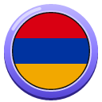 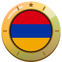

1. [Photograph the whole Cascade in Yerevan in daylight.](https://cogvivo.com/en/challenge/land-am-1)
2. [Take a selfie with Mount Ararat in the background, for example from the top of the Cascade.](https://cogvivo.com/en/challenge/land-am-2)
3. [Photograph a monument outside Yerevan. Choose one from the list.](https://cogvivo.com/en/challenge/land-am-3)
4. [Taste lavash with cheese and herbs or tolma. Film your reaction.](https://cogvivo.com/en/challenge/land-am-4)
5. [Order something in Armenian: say 'Barev dzez' and 'Shnorhakalutyun'. Film yourself.](https://cogvivo.com/en/challenge/land-am-5)

**[▶ Open Armenia on Cogvivo](https://cogvivo.com/en/country/AM)**

## Austria

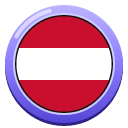 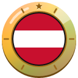

1. [Photograph the whole St. Stephen's Cathedral in daylight.](https://cogvivo.com/en/challenge/land-at-1)
2. [Take a selfie with Schönbrunn Palace or the Belvedere behind you.](https://cogvivo.com/en/challenge/land-at-2)
3. [Photograph a monument outside Vienna. Choose one from the list.](https://cogvivo.com/en/challenge/land-at-3)
4. [Taste Sachertorte or apple strudel in a Viennese coffee house. Film your reaction.](https://cogvivo.com/en/challenge/land-at-4)
5. [Order something in German: say 'Grüß Gott' and 'Danke'. Film yourself.](https://cogvivo.com/en/challenge/land-at-5)

**[▶ Open Austria on Cogvivo](https://cogvivo.com/en/country/AT)**

## Azerbaijan

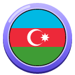 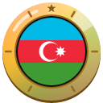

1. [Photograph the whole Maiden Tower in Baku's Old City.](https://cogvivo.com/en/challenge/land-az-1)
2. [Take a selfie with the Flame Towers or the Heydar Aliyev Center behind you.](https://cogvivo.com/en/challenge/land-az-2)
3. [Photograph a monument outside Baku. Choose one from the list.](https://cogvivo.com/en/challenge/land-az-3)
4. [Taste plov or qutab with herbs. Film your reaction.](https://cogvivo.com/en/challenge/land-az-4)
5. [Order something in Azerbaijani: say 'Salam' and 'Sağ ol'. Film yourself.](https://cogvivo.com/en/challenge/land-az-5)

**[▶ Open Azerbaijan on Cogvivo](https://cogvivo.com/en/country/AZ)**

## Belarus

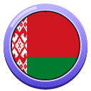 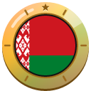

1. [Photograph the whole Holy Spirit Cathedral in Minsk in daylight.](https://cogvivo.com/en/challenge/land-by-1)
2. [Take a selfie with the National Library of Belarus behind you.](https://cogvivo.com/en/challenge/land-by-2)
3. [Photograph a monument outside Minsk. Choose one from the list.](https://cogvivo.com/en/challenge/land-by-3)
4. [Taste draniki (potato pancakes) or kholodnik (cold beetroot soup). Film your reaction.](https://cogvivo.com/en/challenge/land-by-4)
5. [Order something in Belarusian: say 'Dobry dzień' and 'Dziakuj'. Film yourself.](https://cogvivo.com/en/challenge/land-by-5)

**[▶ Open Belarus on Cogvivo](https://cogvivo.com/en/country/BY)**

## Belgium

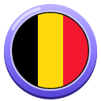 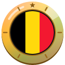

1. [Photograph the Grand-Place in Brussels in daylight.](https://cogvivo.com/en/challenge/land-be-1)
2. [Take a selfie at Manneken Pis or the triumphal arch in Cinquantenaire Park.](https://cogvivo.com/en/challenge/land-be-2)
3. [Photograph a monument outside Brussels. Choose one from the list.](https://cogvivo.com/en/challenge/land-be-3)
4. [Taste Belgian fries or a Liège waffle. Film your reaction.](https://cogvivo.com/en/challenge/land-be-4)
5. [Order something in French: say 'Bonjour' and 'Merci'. Film yourself.](https://cogvivo.com/en/challenge/land-be-5)

**[▶ Open Belgium on Cogvivo](https://cogvivo.com/en/country/BE)**

## Bosnia and Herzegovina

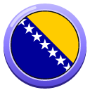 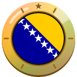

1. [Photograph the Sebilj wooden fountain in Baščaršija in daylight.](https://cogvivo.com/en/challenge/land-ba-1)
2. [Take a selfie at the Latin Bridge or the Gazi Husrev-beg Mosque.](https://cogvivo.com/en/challenge/land-ba-2)
3. [Photograph a monument outside Sarajevo. Choose one from the list.](https://cogvivo.com/en/challenge/land-ba-3)
4. [Taste ćevapi or sirnica (cheese pie). Film your reaction.](https://cogvivo.com/en/challenge/land-ba-4)
5. [Order something in Bosnian: say 'Zdravo' and 'Hvala'. Film yourself.](https://cogvivo.com/en/challenge/land-ba-5)

**[▶ Open Bosnia and Herzegovina on Cogvivo](https://cogvivo.com/en/country/BA)**

## Bulgaria

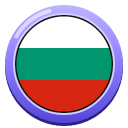 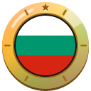

1. [Photograph the whole Alexander Nevsky Cathedral in daylight.](https://cogvivo.com/en/challenge/land-bg-1)
2. [Take a selfie at St Nedelya Cathedral or the Banya Bashi Mosque.](https://cogvivo.com/en/challenge/land-bg-2)
3. [Photograph a monument outside Sofia. Choose one from the list.](https://cogvivo.com/en/challenge/land-bg-3)
4. [Taste banitsa or shopska salad. Film your reaction.](https://cogvivo.com/en/challenge/land-bg-4)
5. [Order something in Bulgarian: say 'Zdraveyte' and 'Blagodarya'. Film yourself.](https://cogvivo.com/en/challenge/land-bg-5)

**[▶ Open Bulgaria on Cogvivo](https://cogvivo.com/en/country/BG)**

## Croatia

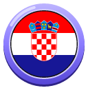 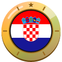

1. [Photograph the Peristyle of Diocletian's Palace in daylight.](https://cogvivo.com/en/challenge/land-hr-1)
2. [Take a selfie with the view over Split from Marjan Hill or St. Domnius bell tower.](https://cogvivo.com/en/challenge/land-hr-2)
3. [Photograph a monument outside Split. Choose one from the list.](https://cogvivo.com/en/challenge/land-hr-3)
4. [Taste soparnik (Swiss chard pie) or crni rižot (black risotto). Film your reaction.](https://cogvivo.com/en/challenge/land-hr-4)
5. [Order something in Croatian: say 'Dobar dan' and 'Hvala'. Film yourself.](https://cogvivo.com/en/challenge/land-hr-5)

**[▶ Open Croatia on Cogvivo](https://cogvivo.com/en/country/HR)**

## Cyprus

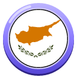 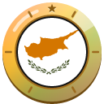

1. [Photograph the whole Paphos Castle at the harbour in daylight.](https://cogvivo.com/en/challenge/land-cy-1)
2. [Take a selfie in the Paphos Archaeological Park or at the harbour.](https://cogvivo.com/en/challenge/land-cy-2)
3. [Photograph a monument outside Paphos. Choose one from the list.](https://cogvivo.com/en/challenge/land-cy-3)
4. [Taste grilled halloumi or souvlaki. Film your reaction.](https://cogvivo.com/en/challenge/land-cy-4)
5. [Order something in Greek: say 'Yia sas' and 'Efcharistó'. Film yourself.](https://cogvivo.com/en/challenge/land-cy-5)

**[▶ Open Cyprus on Cogvivo](https://cogvivo.com/en/country/CY)**

## Czechia

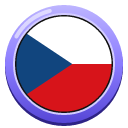 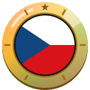

1. [Photograph the whole Charles Bridge from the riverbank in daylight.](https://cogvivo.com/en/challenge/land-cz-1)
2. [Take a selfie at the Astronomical Clock or the Týn Church.](https://cogvivo.com/en/challenge/land-cz-2)
3. [Photograph a monument outside Prague. Choose one from the list.](https://cogvivo.com/en/challenge/land-cz-3)
4. [Taste svíčková or smažený sýr (fried cheese). Film your reaction.](https://cogvivo.com/en/challenge/land-cz-4)
5. [Order something in Czech: say 'Dobrý den' and 'Děkuji'. Film yourself.](https://cogvivo.com/en/challenge/land-cz-5)

**[▶ Open Czechia on Cogvivo](https://cogvivo.com/en/country/CZ)**

## Denmark

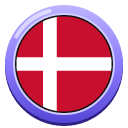 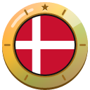

1. [Photograph the colourful houses of Nyhavn in daylight.](https://cogvivo.com/en/challenge/land-dk-1)
2. [Take a selfie on top of the Round Tower or at Rosenborg Castle.](https://cogvivo.com/en/challenge/land-dk-2)
3. [Photograph a monument outside Copenhagen. Choose one from the list.](https://cogvivo.com/en/challenge/land-dk-3)
4. [Taste smørrebrød or a kanelsnegl (cinnamon roll). Film your reaction.](https://cogvivo.com/en/challenge/land-dk-4)
5. [Order something in Danish: say 'Hej' and 'Tak'. Film yourself.](https://cogvivo.com/en/challenge/land-dk-5)

**[▶ Open Denmark on Cogvivo](https://cogvivo.com/en/country/DK)**

## Estonia

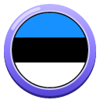 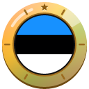

1. [Photograph Town Hall Square with the old town hall in daylight.](https://cogvivo.com/en/challenge/land-ee-1)
2. [Take a selfie at Kohtuotsa or Patkuli viewpoint with the Old Town behind you.](https://cogvivo.com/en/challenge/land-ee-2)
3. [Photograph a monument outside Tallinn. Choose one from the list.](https://cogvivo.com/en/challenge/land-ee-3)
4. [Taste Estonian rye bread or kama with yoghurt. Film your reaction.](https://cogvivo.com/en/challenge/land-ee-4)
5. [Order something in Estonian: say 'Tere' and 'Aitäh'. Film yourself.](https://cogvivo.com/en/challenge/land-ee-5)

**[▶ Open Estonia on Cogvivo](https://cogvivo.com/en/country/EE)**

## Finland

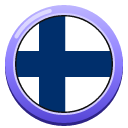 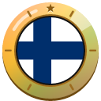

1. [Photograph the whole Helsinki Cathedral in daylight.](https://cogvivo.com/en/challenge/land-fi-1)
2. [Take a selfie at the Rock Church or Uspenski Cathedral.](https://cogvivo.com/en/challenge/land-fi-2)
3. [Photograph a monument outside Helsinki. Choose one from the list.](https://cogvivo.com/en/challenge/land-fi-3)
4. [Taste karjalanpiirakka (Karelian pie) or lohikeitto (salmon soup). Film your reaction.](https://cogvivo.com/en/challenge/land-fi-4)
5. [Visit a public sauna. Film yourself outside afterwards.](https://cogvivo.com/en/challenge/land-fi-5)

**[▶ Open Finland on Cogvivo](https://cogvivo.com/en/country/FI)**

## France

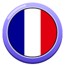 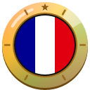

1. [Photograph the whole Eiffel Tower in daylight.](https://cogvivo.com/en/challenge/land-fr-1)
2. [Take a selfie with Notre-Dame or the Arc de Triomphe behind you.](https://cogvivo.com/en/challenge/land-fr-2)
3. [Photograph a monument outside Paris. Choose one from the list.](https://cogvivo.com/en/challenge/land-fr-3)
4. [Taste a fresh baguette or a croissant from a bakery. Film your reaction.](https://cogvivo.com/en/challenge/land-fr-4)
5. [Order something in French: say 'Bonjour' and 'Merci'. Film yourself.](https://cogvivo.com/en/challenge/land-fr-5)

**[▶ Open France on Cogvivo](https://cogvivo.com/en/country/FR)**

## Georgia

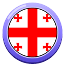 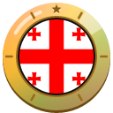

1. [Photograph the whole Sameba Cathedral in Tbilisi in daylight.](https://cogvivo.com/en/challenge/land-ge-1)
2. [Take a selfie with Narikala Fortress or the Abanotubani sulphur baths behind you.](https://cogvivo.com/en/challenge/land-ge-2)
3. [Photograph a monument outside Tbilisi. Choose one from the list.](https://cogvivo.com/en/challenge/land-ge-3)
4. [Taste khachapuri or khinkali with mushrooms. Film your reaction.](https://cogvivo.com/en/challenge/land-ge-4)
5. [Order something in Georgian: say 'Gamarjoba' and 'Madloba'. Film yourself.](https://cogvivo.com/en/challenge/land-ge-5)

**[▶ Open Georgia on Cogvivo](https://cogvivo.com/en/country/GE)**

## Germany

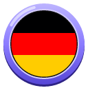 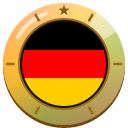

1. [Photograph the whole Brandenburg Gate in daylight.](https://cogvivo.com/en/challenge/land-de-1)
2. [Take a selfie with Berlin Cathedral or the TV Tower behind you.](https://cogvivo.com/en/challenge/land-de-2)
3. [Photograph a monument outside Berlin. Choose one from the list.](https://cogvivo.com/en/challenge/land-de-3)
4. [Taste a currywurst or a Brezel (pretzel). Film your reaction.](https://cogvivo.com/en/challenge/land-de-4)
5. [Order something in German: say 'Hallo' and 'Danke'. Film yourself.](https://cogvivo.com/en/challenge/land-de-5)

**[▶ Open Germany on Cogvivo](https://cogvivo.com/en/country/DE)**

## Greece

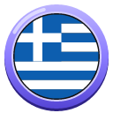 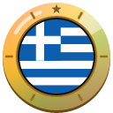

1. [Photograph the Acropolis with the Parthenon in daylight.](https://cogvivo.com/en/challenge/land-gr-1)
2. [Take a selfie on Lycabettus Hill or at the Temple of Olympian Zeus.](https://cogvivo.com/en/challenge/land-gr-2)
3. [Photograph a monument outside Athens. Choose one from the list.](https://cogvivo.com/en/challenge/land-gr-3)
4. [Taste souvlaki or spanakopita (spinach pie). Film your reaction.](https://cogvivo.com/en/challenge/land-gr-4)
5. [Order something in Greek: say 'Yia sas' and 'Efcharistó'. Film yourself.](https://cogvivo.com/en/challenge/land-gr-5)

**[▶ Open Greece on Cogvivo](https://cogvivo.com/en/country/GR)**

## Hungary

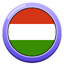 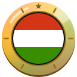

1. [Photograph the whole Chain Bridge over the Danube in daylight.](https://cogvivo.com/en/challenge/land-hu-1)
2. [Take a selfie at Fisherman's Bastion or on Heroes' Square.](https://cogvivo.com/en/challenge/land-hu-2)
3. [Photograph a monument outside Budapest. Choose one from the list.](https://cogvivo.com/en/challenge/land-hu-3)
4. [Taste lángos or goulash soup. Film your reaction.](https://cogvivo.com/en/challenge/land-hu-4)
5. [Order something in Hungarian: say 'Jó napot' and 'Köszönöm'. Film yourself.](https://cogvivo.com/en/challenge/land-hu-5)

**[▶ Open Hungary on Cogvivo](https://cogvivo.com/en/country/HU)**

## Iceland

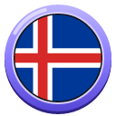 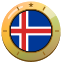

1. [Photograph the whole Hallgrímskirkja in daylight.](https://cogvivo.com/en/challenge/land-is-1)
2. [Take a selfie at Harpa concert hall or the Sun Voyager sculpture by the sea.](https://cogvivo.com/en/challenge/land-is-2)
3. [Photograph a nature spot outside Reykjavík. Choose one from the list.](https://cogvivo.com/en/challenge/land-is-3)
4. [Taste skyr or Icelandic lamb soup (kjötsúpa). Film your reaction.](https://cogvivo.com/en/challenge/land-is-4)
5. [Order something in Icelandic: say 'Góðan daginn' and 'Takk'. Film yourself.](https://cogvivo.com/en/challenge/land-is-5)

**[▶ Open Iceland on Cogvivo](https://cogvivo.com/en/country/IS)**

## Ireland

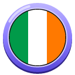 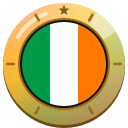

1. [Photograph the whole Ha'penny Bridge over the Liffey in daylight.](https://cogvivo.com/en/challenge/land-ie-1)
2. [Take a selfie at Trinity College or St Patrick's Cathedral.](https://cogvivo.com/en/challenge/land-ie-2)
3. [Photograph a monument outside Dublin. Choose one from the list.](https://cogvivo.com/en/challenge/land-ie-3)
4. [Taste Irish stew or boxty (potato pancake). Film your reaction.](https://cogvivo.com/en/challenge/land-ie-4)
5. [Say 'Dia duit' (hello in Irish) when you order something. Film yourself.](https://cogvivo.com/en/challenge/land-ie-5)

**[▶ Open Ireland on Cogvivo](https://cogvivo.com/en/country/IE)**

## Italy

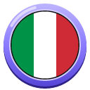 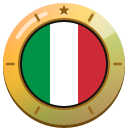

1. [Photograph the whole Colosseum in daylight.](https://cogvivo.com/en/challenge/land-it-1)
2. [Take a selfie at the Trevi Fountain or the Pantheon.](https://cogvivo.com/en/challenge/land-it-2)
3. [Photograph a monument outside Rome. Choose one from the list.](https://cogvivo.com/en/challenge/land-it-3)
4. [Taste pizza margherita or pasta cacio e pepe. Film your reaction.](https://cogvivo.com/en/challenge/land-it-4)
5. [Order something in Italian: say 'Buongiorno' and 'Grazie'. Film yourself.](https://cogvivo.com/en/challenge/land-it-5)

**[▶ Open Italy on Cogvivo](https://cogvivo.com/en/country/IT)**

## Kosovo

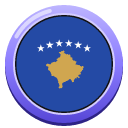 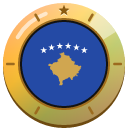

1. [Photograph the whole National Library of Kosovo in daylight.](https://cogvivo.com/en/challenge/land-xk-1)
2. [Take a selfie at the Newborn monument or Mother Teresa Cathedral.](https://cogvivo.com/en/challenge/land-xk-2)
3. [Photograph a monument outside Pristina. Choose one from the list.](https://cogvivo.com/en/challenge/land-xk-3)
4. [Taste flija or cheese pite. Film your reaction.](https://cogvivo.com/en/challenge/land-xk-4)
5. [Order something in Albanian: say 'Përshëndetje' and 'Faleminderit'. Film yourself.](https://cogvivo.com/en/challenge/land-xk-5)

**[▶ Open Kosovo on Cogvivo](https://cogvivo.com/en/country/XK)**

## Latvia

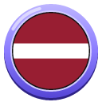 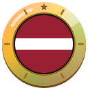

1. [Photograph the whole House of the Blackheads in daylight.](https://cogvivo.com/en/challenge/land-lv-1)
2. [Take a selfie on St. Peter's Church tower or at the Central Market.](https://cogvivo.com/en/challenge/land-lv-2)
3. [Photograph a monument outside Riga. Choose one from the list.](https://cogvivo.com/en/challenge/land-lv-3)
4. [Taste Latvian rye bread or rupjmaizes kārtojums (rye bread dessert). Film your reaction.](https://cogvivo.com/en/challenge/land-lv-4)
5. [Order something in Latvian: say 'Labdien' and 'Paldies'. Film yourself.](https://cogvivo.com/en/challenge/land-lv-5)

**[▶ Open Latvia on Cogvivo](https://cogvivo.com/en/country/LV)**

## Liechtenstein

 

1. [Photograph St. Florin's Cathedral in Vaduz in daylight.](https://cogvivo.com/en/challenge/land-li-1)
2. [Take a selfie on the old wooden Rhine bridge between Vaduz and Sevelen.](https://cogvivo.com/en/challenge/land-li-2)
3. [Photograph a monument outside Vaduz. Choose one from the list.](https://cogvivo.com/en/challenge/land-li-3)
4. [Taste Käsknöpfle or Ribel (maize dish). Film your reaction.](https://cogvivo.com/en/challenge/land-li-4)
5. [Get a souvenir stamp in your passport at the Liechtenstein Center. Film the stamp.](https://cogvivo.com/en/challenge/land-li-5)

**[▶ Open Liechtenstein on Cogvivo](https://cogvivo.com/en/country/LI)**

## Lithuania

 

1. [Photograph Vilnius Cathedral with its bell tower in daylight.](https://cogvivo.com/en/challenge/land-lt-1)
2. [Take a selfie at Gediminas Tower or the Gate of Dawn.](https://cogvivo.com/en/challenge/land-lt-2)
3. [Photograph a monument outside Vilnius. Choose one from the list.](https://cogvivo.com/en/challenge/land-lt-3)
4. [Taste cepelinai or šaltibarščiai (cold beetroot soup). Film your reaction.](https://cogvivo.com/en/challenge/land-lt-4)
5. [Order something in Lithuanian: say 'Labas' and 'Ačiū'. Film yourself.](https://cogvivo.com/en/challenge/land-lt-5)

**[▶ Open Lithuania on Cogvivo](https://cogvivo.com/en/country/LT)**

## Luxembourg

 

1. [Photograph the Bock Casemates from the Corniche in daylight.](https://cogvivo.com/en/challenge/land-lu-1)
2. [Take a selfie at Adolphe Bridge or on the Corniche with the Grund district behind you.](https://cogvivo.com/en/challenge/land-lu-2)
3. [Photograph a monument outside Luxembourg City. Choose one from the list.](https://cogvivo.com/en/challenge/land-lu-3)
4. [Taste Gromperekichelcher (potato fritters) or Bouneschlupp (bean soup). Film your reaction.](https://cogvivo.com/en/challenge/land-lu-4)
5. [Order something in Luxembourgish: say 'Moien' and 'Merci'. Film yourself.](https://cogvivo.com/en/challenge/land-lu-5)

**[▶ Open Luxembourg on Cogvivo](https://cogvivo.com/en/country/LU)**

## Malta

 

1. [Photograph the Grand Harbour from the Upper Barrakka Gardens in daylight.](https://cogvivo.com/en/challenge/land-mt-1)
2. [Take a selfie on the Sliema waterfront with the Valletta skyline behind you.](https://cogvivo.com/en/challenge/land-mt-2)
3. [Photograph a monument outside Valletta. Choose one from the list.](https://cogvivo.com/en/challenge/land-mt-3)
4. [Taste pastizzi with ricotta or a Maltese ftira. Film your reaction.](https://cogvivo.com/en/challenge/land-mt-4)
5. [Order something in Maltese: say 'Bonġu' and 'Grazzi'. Film yourself.](https://cogvivo.com/en/challenge/land-mt-5)

**[▶ Open Malta on Cogvivo](https://cogvivo.com/en/country/MT)**

## Moldova

 

1. [Photograph the whole Cathedral of Christ's Nativity in Chișinău in daylight.](https://cogvivo.com/en/challenge/land-md-1)
2. [Take a selfie at the Stephen the Great monument.](https://cogvivo.com/en/challenge/land-md-2)
3. [Photograph a monument outside Chișinău. Choose one from the list.](https://cogvivo.com/en/challenge/land-md-3)
4. [Taste mămăligă with brânză cheese or plăcinte (filled pastry). Film your reaction.](https://cogvivo.com/en/challenge/land-md-4)
5. [Order something in Romanian: say 'Bună ziua' and 'Mulțumesc'. Film yourself.](https://cogvivo.com/en/challenge/land-md-5)

**[▶ Open Moldova on Cogvivo](https://cogvivo.com/en/country/MD)**

## Monaco

 

1. [Photograph the whole façade of the Oceanographic Museum in daylight.](https://cogvivo.com/en/challenge/land-mc-1)
2. [Take a selfie at Port Hercule harbour or in the Japanese Garden.](https://cogvivo.com/en/challenge/land-mc-2)
3. [Photograph a monument in another district of Monaco. Choose one from the list.](https://cogvivo.com/en/challenge/land-mc-3)
4. [Taste barbagiuan or socca. Film your reaction.](https://cogvivo.com/en/challenge/land-mc-4)
5. [Order something in French: say 'Bonjour' and 'Merci'. Film yourself.](https://cogvivo.com/en/challenge/land-mc-5)

**[▶ Open Monaco on Cogvivo](https://cogvivo.com/en/country/MC)**

## Montenegro

 

1. [Photograph the Sea Gate of Kotor's Old Town in daylight.](https://cogvivo.com/en/challenge/land-me-1)
2. [Climb to San Giovanni Fortress and take a selfie with the bay behind you.](https://cogvivo.com/en/challenge/land-me-2)
3. [Photograph a monument outside Kotor. Choose one from the list.](https://cogvivo.com/en/challenge/land-me-3)
4. [Taste kačamak or Njeguši cheese. Film your reaction.](https://cogvivo.com/en/challenge/land-me-4)
5. [Order something in Montenegrin: say 'Dobar dan' and 'Hvala'. Film yourself.](https://cogvivo.com/en/challenge/land-me-5)

**[▶ Open Montenegro on Cogvivo](https://cogvivo.com/en/country/ME)**

## Netherlands

 

1. [Photograph the whole Rijksmuseum in daylight.](https://cogvivo.com/en/challenge/land-nl-1)
2. [Take a selfie on the Magere Brug or at the Flower Market.](https://cogvivo.com/en/challenge/land-nl-2)
3. [Photograph a monument outside Amsterdam. Choose one from the list.](https://cogvivo.com/en/challenge/land-nl-3)
4. [Taste a fresh stroopwafel or Dutch new herring. Film your reaction.](https://cogvivo.com/en/challenge/land-nl-4)
5. [Order something in Dutch: say 'Hallo' and 'Dank je wel'. Film yourself.](https://cogvivo.com/en/challenge/land-nl-5)

**[▶ Open Netherlands on Cogvivo](https://cogvivo.com/en/country/NL)**

## North Macedonia

 

1. [Photograph the Church of St. John at Kaneo above Lake Ohrid.](https://cogvivo.com/en/challenge/land-mk-1)
2. [Take a selfie at Samuel's Fortress or the Ancient Theatre of Ohrid.](https://cogvivo.com/en/challenge/land-mk-2)
3. [Photograph a monument outside Ohrid. Choose one from the list.](https://cogvivo.com/en/challenge/land-mk-3)
4. [Taste tavče gravče (baked beans) or ajvar with bread. Film your reaction.](https://cogvivo.com/en/challenge/land-mk-4)
5. [Order something in Macedonian: say 'Zdravo' and 'Blagodaram'. Film yourself.](https://cogvivo.com/en/challenge/land-mk-5)

**[▶ Open North Macedonia on Cogvivo](https://cogvivo.com/en/country/MK)**

## Norway

 

1. [Photograph the whole Oslo Opera House in daylight.](https://cogvivo.com/en/challenge/land-no-1)
2. [Take a selfie at the Monolith in Vigeland Park or the Holmenkollen ski jump.](https://cogvivo.com/en/challenge/land-no-2)
3. [Photograph a monument outside Oslo. Choose one from the list.](https://cogvivo.com/en/challenge/land-no-3)
4. [Taste brunost (brown cheese) on a waffle or Norwegian fish soup. Film your reaction.](https://cogvivo.com/en/challenge/land-no-4)
5. [Order something in Norwegian: say 'Hei' and 'Takk'. Film yourself.](https://cogvivo.com/en/challenge/land-no-5)

**[▶ Open Norway on Cogvivo](https://cogvivo.com/en/country/NO)**

## Poland

 

1. [Photograph the whole Cloth Hall on the Main Square in daylight.](https://cogvivo.com/en/challenge/land-pl-1)
2. [Take a selfie with Wawel Castle or St. Mary's Basilica behind you.](https://cogvivo.com/en/challenge/land-pl-2)
3. [Photograph a monument outside Kraków. Choose one from the list.](https://cogvivo.com/en/challenge/land-pl-3)
4. [Taste pierogi ruskie (potato and cheese) or an obwarzanek (Kraków bread ring). Film your reaction.](https://cogvivo.com/en/challenge/land-pl-4)
5. [Order something in Polish: say 'Dzień dobry' and 'Dziękuję'. Film yourself.](https://cogvivo.com/en/challenge/land-pl-5)

**[▶ Open Poland on Cogvivo](https://cogvivo.com/en/country/PL)**

## Portugal

 

1. [Photograph the whole Belém Tower in daylight.](https://cogvivo.com/en/challenge/land-pt-1)
2. [Take a selfie at Jerónimos Monastery or the Santa Luzia viewpoint.](https://cogvivo.com/en/challenge/land-pt-2)
3. [Photograph a monument outside Lisbon. Choose one from the list.](https://cogvivo.com/en/challenge/land-pt-3)
4. [Taste a pastel de nata or bacalhau à brás. Film your reaction.](https://cogvivo.com/en/challenge/land-pt-4)
5. [Order something in Portuguese: say 'Bom dia' and 'Obrigado'. Film yourself.](https://cogvivo.com/en/challenge/land-pt-5)

**[▶ Open Portugal on Cogvivo](https://cogvivo.com/en/country/PT)**

## Romania

 

1. [Photograph the whole Romanian Athenaeum in daylight.](https://cogvivo.com/en/challenge/land-ro-1)
2. [Take a selfie at Stavropoleos Monastery or the Arcul de Triumf.](https://cogvivo.com/en/challenge/land-ro-2)
3. [Photograph a monument outside Bucharest. Choose one from the list.](https://cogvivo.com/en/challenge/land-ro-3)
4. [Taste sarmale or papanași. Film your reaction.](https://cogvivo.com/en/challenge/land-ro-4)
5. [Order something in Romanian: say 'Bună ziua' and 'Mulțumesc'. Film yourself.](https://cogvivo.com/en/challenge/land-ro-5)

**[▶ Open Romania on Cogvivo](https://cogvivo.com/en/country/RO)**

## Russia

 

1. [Photograph the whole St. Basil's Cathedral on Red Square in daylight.](https://cogvivo.com/en/challenge/land-ru-1)
2. [Take a selfie on the Floating Bridge in Zaryadye Park.](https://cogvivo.com/en/challenge/land-ru-2)
3. [Photograph a monument outside Moscow. Choose one from the list.](https://cogvivo.com/en/challenge/land-ru-3)
4. [Taste pelmeni or syrniki (curd cheese pancakes). Film your reaction.](https://cogvivo.com/en/challenge/land-ru-4)
5. [Order something in Russian: say 'Zdravstvujte' and 'Spasibo'. Film yourself.](https://cogvivo.com/en/challenge/land-ru-5)

**[▶ Open Russia on Cogvivo](https://cogvivo.com/en/country/RU)**

## San Marino

 

1. [Photograph Guaita Tower on Mount Titano in daylight.](https://cogvivo.com/en/challenge/land-sm-1)
2. [Take a selfie at the second tower, Cesta, with the view behind you.](https://cogvivo.com/en/challenge/land-sm-2)
3. [Photograph a monument outside the old town. Choose one from the list.](https://cogvivo.com/en/challenge/land-sm-3)
4. [Taste torta Tre Monti or a piadina with cheese. Film your reaction.](https://cogvivo.com/en/challenge/land-sm-4)
5. [Get a souvenir stamp in your passport at the tourist office. Film the stamp.](https://cogvivo.com/en/challenge/land-sm-5)

**[▶ Open San Marino on Cogvivo](https://cogvivo.com/en/country/SM)**

## Serbia

 

1. [Photograph the whole Church of Saint Sava in daylight.](https://cogvivo.com/en/challenge/land-rs-1)
2. [Take a selfie in Kalemegdan Park with the meeting of the Sava and Danube behind you.](https://cogvivo.com/en/challenge/land-rs-2)
3. [Photograph a monument outside Belgrade. Choose one from the list.](https://cogvivo.com/en/challenge/land-rs-3)
4. [Taste pljeskavica or gibanica (cheese pie). Film your reaction.](https://cogvivo.com/en/challenge/land-rs-4)
5. [Order something in Serbian: say 'Zdravo' and 'Hvala'. Film yourself.](https://cogvivo.com/en/challenge/land-rs-5)

**[▶ Open Serbia on Cogvivo](https://cogvivo.com/en/country/RS)**

## Slovakia

 

1. [Photograph the whole Bratislava Castle in daylight.](https://cogvivo.com/en/challenge/land-sk-1)
2. [Take a selfie at St. Michael's Gate or the Blue Church.](https://cogvivo.com/en/challenge/land-sk-2)
3. [Photograph a monument outside Bratislava. Choose one from the list.](https://cogvivo.com/en/challenge/land-sk-3)
4. [Taste bryndzové halušky or lokše (potato pancakes). Film your reaction.](https://cogvivo.com/en/challenge/land-sk-4)
5. [Order something in Slovak: say 'Dobrý deň' and 'Ďakujem'. Film yourself.](https://cogvivo.com/en/challenge/land-sk-5)

**[▶ Open Slovakia on Cogvivo](https://cogvivo.com/en/country/SK)**

## Slovenia

 

1. [Photograph the pink Franciscan Church on Prešeren Square in daylight.](https://cogvivo.com/en/challenge/land-si-1)
2. [Take a selfie at the Dragon Bridge or at Ljubljana Castle.](https://cogvivo.com/en/challenge/land-si-2)
3. [Photograph a monument outside Ljubljana. Choose one from the list.](https://cogvivo.com/en/challenge/land-si-3)
4. [Taste štruklji or potica (nut roll). Film your reaction.](https://cogvivo.com/en/challenge/land-si-4)
5. [Order something in Slovene: say 'Dober dan' and 'Hvala'. Film yourself.](https://cogvivo.com/en/challenge/land-si-5)

**[▶ Open Slovenia on Cogvivo](https://cogvivo.com/en/country/SI)**

## Spain

 

1. [Photograph the whole Sagrada Família in daylight.](https://cogvivo.com/en/challenge/land-es-1)
2. [Take a selfie in Park Güell or at Casa Batlló.](https://cogvivo.com/en/challenge/land-es-2)
3. [Photograph a monument outside Barcelona. Choose one from the list.](https://cogvivo.com/en/challenge/land-es-3)
4. [Taste pa amb tomàquet (bread with tomato) or paella. Film your reaction.](https://cogvivo.com/en/challenge/land-es-4)
5. [Order something in Spanish: say 'Hola' and 'Gracias'. Film yourself.](https://cogvivo.com/en/challenge/land-es-5)

**[▶ Open Spain on Cogvivo](https://cogvivo.com/en/country/ES)**

## Sweden

 

1. [Photograph the colourful houses on Stortorget in Gamla stan in daylight.](https://cogvivo.com/en/challenge/land-se-1)
2. [Take a selfie with the Vasa ship in the Vasa Museum.](https://cogvivo.com/en/challenge/land-se-2)
3. [Photograph a monument outside Stockholm. Choose one from the list.](https://cogvivo.com/en/challenge/land-se-3)
4. [Taste köttbullar (meatballs) or a kanelbulle at fika. Film your reaction.](https://cogvivo.com/en/challenge/land-se-4)
5. [Order something in Swedish: say 'Hej' and 'Tack'. Film yourself.](https://cogvivo.com/en/challenge/land-se-5)

**[▶ Open Sweden on Cogvivo](https://cogvivo.com/en/country/SE)**

## Switzerland

 

1. [Photograph the whole Chapel Bridge with the Water Tower in daylight.](https://cogvivo.com/en/challenge/land-ch-1)
2. [Take a selfie on the summit of Mount Pilatus or Mount Rigi.](https://cogvivo.com/en/challenge/land-ch-2)
3. [Photograph a monument outside Lucerne. Choose one from the list.](https://cogvivo.com/en/challenge/land-ch-3)
4. [Taste rösti or raclette. Film your reaction.](https://cogvivo.com/en/challenge/land-ch-4)
5. [Order something in German: say 'Grüezi' and 'Merci vielmal'. Film yourself.](https://cogvivo.com/en/challenge/land-ch-5)

**[▶ Open Switzerland on Cogvivo](https://cogvivo.com/en/country/CH)**

## Türkiye

 

1. [Photograph the whole Hagia Sophia from outside in daylight.](https://cogvivo.com/en/challenge/land-tr-1)
2. [Take a selfie with the Blue Mosque or the Galata Tower behind you.](https://cogvivo.com/en/challenge/land-tr-2)
3. [Photograph a monument outside Istanbul. Choose one from the list.](https://cogvivo.com/en/challenge/land-tr-3)
4. [Taste mercimek çorbası (lentil soup) or lahmacun. Film your reaction.](https://cogvivo.com/en/challenge/land-tr-4)
5. [Order something in Turkish: say 'Merhaba' and 'Teşekkürler'. Film yourself.](https://cogvivo.com/en/challenge/land-tr-5)

**[▶ Open Türkiye on Cogvivo](https://cogvivo.com/en/country/TR)**

## Ukraine

 

1. [Photograph the whole Saint Sophia Cathedral in Kyiv in daylight.](https://cogvivo.com/en/challenge/land-ua-1)
2. [Take a selfie on Andriyivskyy Descent with St Andrew's Church behind you.](https://cogvivo.com/en/challenge/land-ua-2)
3. [Photograph a monument outside Kyiv. Choose one from the list.](https://cogvivo.com/en/challenge/land-ua-3)
4. [Taste varenyky with potato or with cherries. Film your reaction.](https://cogvivo.com/en/challenge/land-ua-4)
5. [Order something in Ukrainian: say 'Dobryi den' and 'Diakuiu'. Film yourself.](https://cogvivo.com/en/challenge/land-ua-5)

**[▶ Open Ukraine on Cogvivo](https://cogvivo.com/en/country/UA)**

## United Kingdom

 

1. [Photograph the whole Tower Bridge in daylight.](https://cogvivo.com/en/challenge/land-gb-1)
2. [Take a selfie with St Paul's Cathedral or the London Eye behind you.](https://cogvivo.com/en/challenge/land-gb-2)
3. [Photograph a monument outside London. Choose one from the list.](https://cogvivo.com/en/challenge/land-gb-3)
4. [Taste fish and chips or a scone with clotted cream. Film your reaction.](https://cogvivo.com/en/challenge/land-gb-4)
5. [Film yourself in the front seat upstairs on a red double-decker bus.](https://cogvivo.com/en/challenge/land-gb-5)

**[▶ Open United Kingdom on Cogvivo](https://cogvivo.com/en/country/GB)**

## Vatican City

 

1. [Photograph the whole façade of St. Peter's Basilica in daylight.](https://cogvivo.com/en/challenge/land-va-1)
2. [Take a selfie in St. Peter's Square with the obelisk behind you.](https://cogvivo.com/en/challenge/land-va-2)
3. [Photograph a monument in Vatican City beyond the square. Choose one from the list.](https://cogvivo.com/en/challenge/land-va-3)
4. [Send a postcard with a Vatican stamp through the Vatican post. Film the posting.](https://cogvivo.com/en/challenge/land-va-4)
5. [Order something in Italian: say 'Buongiorno' and 'Grazie'. Film yourself.](https://cogvivo.com/en/challenge/land-va-5)

**[▶ Open Vatican City on Cogvivo](https://cogvivo.com/en/country/VA)**

---

© 2026 Tim Wijnands. Cogvivo™, its texts, challenges and badges are protected: public to view and to help with, not to copy or reuse. See [LICENSE](../../LICENSE).

*This page is generated automatically from the app. Changes made here by hand are overwritten.*
