# Country challenges: Middle East & South Asia

[← All continents](README.md)

## Afghanistan

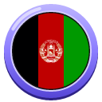 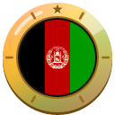

1. [Photograph the Gardens of Babur in Kabul in daylight.](https://cogvivo.com/en/challenge/land-af-1)
2. [Take a selfie at Qargha Lake near Kabul.](https://cogvivo.com/en/challenge/land-af-2)
3. [Photograph a monument outside Kabul in daylight: choose one from the list.](https://cogvivo.com/en/challenge/land-af-3)
4. [Taste Kabuli pulao or bolani. Film your reaction.](https://cogvivo.com/en/challenge/land-af-4)
5. [Film yourself: say hello and order something in Dari or Pashto.](https://cogvivo.com/en/challenge/land-af-5)

**[▶ Open Afghanistan on Cogvivo](https://cogvivo.com/en/country/AF)**

## Bahrain

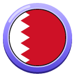 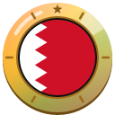

1. [Photograph the whole Bab Al Bahrain in daylight.](https://cogvivo.com/en/challenge/land-bh-1)
2. [Take a selfie at Qal'at al-Bahrain with the fort behind you.](https://cogvivo.com/en/challenge/land-bh-2)
3. [Photograph a place outside Manama in daylight: choose one from the list.](https://cogvivo.com/en/challenge/land-bh-3)
4. [Taste machboos or muhammar. Film your reaction.](https://cogvivo.com/en/challenge/land-bh-4)
5. [Film only yourself: say hello and order something in Arabic.](https://cogvivo.com/en/challenge/land-bh-5)

**[▶ Open Bahrain on Cogvivo](https://cogvivo.com/en/country/BH)**

## Bangladesh

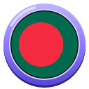 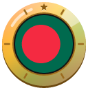

1. [Photograph Lalbagh Fort in daylight.](https://cogvivo.com/en/challenge/land-bd-1)
2. [Take a selfie with Ahsan Manzil, the Pink Palace, behind you.](https://cogvivo.com/en/challenge/land-bd-2)
3. [Photograph a monument outside Dhaka in daylight: choose one from the list.](https://cogvivo.com/en/challenge/land-bd-3)
4. [Taste ilish or khichuri. Film your reaction.](https://cogvivo.com/en/challenge/land-bd-4)
5. [Film yourself: say hello and order something in Bengali.](https://cogvivo.com/en/challenge/land-bd-5)

**[▶ Open Bangladesh on Cogvivo](https://cogvivo.com/en/country/BD)**

## Bhutan

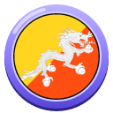 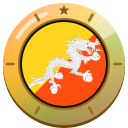

1. [Photograph Rinpung Dzong from outside in daylight.](https://cogvivo.com/en/challenge/land-bt-1)
2. [Take a selfie at the viewpoint with Tiger's Nest Monastery behind you.](https://cogvivo.com/en/challenge/land-bt-2)
3. [Photograph a place outside Paro in daylight: choose one from the list.](https://cogvivo.com/en/challenge/land-bt-3)
4. [Taste ema datshi or momo. Film your reaction.](https://cogvivo.com/en/challenge/land-bt-4)
5. [Film yourself: say hello and order something in Dzongkha.](https://cogvivo.com/en/challenge/land-bt-5)

**[▶ Open Bhutan on Cogvivo](https://cogvivo.com/en/country/BT)**

## India

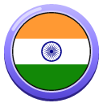 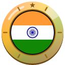

1. [Photograph the whole Qutub Minar in daylight.](https://cogvivo.com/en/challenge/land-in-1)
2. [Take a selfie with Humayun's Tomb behind you.](https://cogvivo.com/en/challenge/land-in-2)
3. [Photograph a monument outside Delhi in daylight: choose one from the list.](https://cogvivo.com/en/challenge/land-in-3)
4. [Taste chole bhature or butter chicken. Film your reaction.](https://cogvivo.com/en/challenge/land-in-4)
5. [Film yourself: say hello and order something in Hindi.](https://cogvivo.com/en/challenge/land-in-5)

**[▶ Open India on Cogvivo](https://cogvivo.com/en/country/IN)**

## Iran

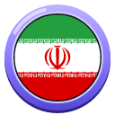 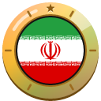

1. [Photograph the whole Azadi Tower in Tehran in daylight.](https://cogvivo.com/en/challenge/land-ir-1)
2. [Take a selfie in the garden of Golestan Palace.](https://cogvivo.com/en/challenge/land-ir-2)
3. [Photograph a monument outside Tehran in daylight: choose one from the list.](https://cogvivo.com/en/challenge/land-ir-3)
4. [Taste ghormeh sabzi or kashk-e bademjan. Film your reaction.](https://cogvivo.com/en/challenge/land-ir-4)
5. [Film yourself: say hello and order something in Persian.](https://cogvivo.com/en/challenge/land-ir-5)

**[▶ Open Iran on Cogvivo](https://cogvivo.com/en/country/IR)**

## Iraq

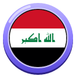 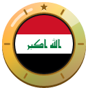

1. [Photograph the whole Erbil Citadel in daylight.](https://cogvivo.com/en/challenge/land-iq-1)
2. [Take a selfie with the Mudhafaria Minaret in Erbil behind you.](https://cogvivo.com/en/challenge/land-iq-2)
3. [Photograph a monument outside Erbil in daylight: choose one from the list.](https://cogvivo.com/en/challenge/land-iq-3)
4. [Taste dolma or masgouf (grilled fish). Film your reaction.](https://cogvivo.com/en/challenge/land-iq-4)
5. [Film yourself: say hello and order something in Kurdish or Arabic.](https://cogvivo.com/en/challenge/land-iq-5)

**[▶ Open Iraq on Cogvivo](https://cogvivo.com/en/country/IQ)**

## Israel

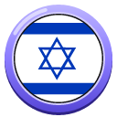 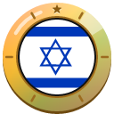

1. [Photograph the whole Jaffa Clock Tower in daylight.](https://cogvivo.com/en/challenge/land-il-1)
2. [Take a selfie on the Tel Aviv promenade with the sea behind you.](https://cogvivo.com/en/challenge/land-il-2)
3. [Photograph a monument outside Tel Aviv in daylight: choose one from the list.](https://cogvivo.com/en/challenge/land-il-3)
4. [Taste sabich or shakshuka. Film your reaction.](https://cogvivo.com/en/challenge/land-il-4)
5. [Film yourself: say hello and order something in Hebrew.](https://cogvivo.com/en/challenge/land-il-5)

**[▶ Open Israel on Cogvivo](https://cogvivo.com/en/country/IL)**

## Jordan

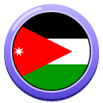 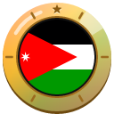

1. [Photograph the Temple of Hercules on the Amman Citadel in daylight.](https://cogvivo.com/en/challenge/land-jo-1)
2. [Take a selfie in the Roman Theatre of Amman.](https://cogvivo.com/en/challenge/land-jo-2)
3. [Photograph a monument outside Amman in daylight: choose one from the list.](https://cogvivo.com/en/challenge/land-jo-3)
4. [Taste mansaf or falafel with hummus. Film your reaction.](https://cogvivo.com/en/challenge/land-jo-4)
5. [Film yourself: say hello and order something in Arabic.](https://cogvivo.com/en/challenge/land-jo-5)

**[▶ Open Jordan on Cogvivo](https://cogvivo.com/en/country/JO)**

## Kazakhstan

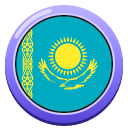 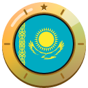

1. [Photograph the whole Zenkov Cathedral in daylight.](https://cogvivo.com/en/challenge/land-kz-1)
2. [Take a selfie on Kok Tobe with Almaty behind you.](https://cogvivo.com/en/challenge/land-kz-2)
3. [Photograph a place outside Almaty in daylight: choose one from the list.](https://cogvivo.com/en/challenge/land-kz-3)
4. [Taste beshbarmak or baursak. Film your reaction.](https://cogvivo.com/en/challenge/land-kz-4)
5. [Film yourself: say hello and order something in Kazakh.](https://cogvivo.com/en/challenge/land-kz-5)

**[▶ Open Kazakhstan on Cogvivo](https://cogvivo.com/en/country/KZ)**

## Kuwait

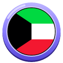 

1. [Photograph the Kuwait Towers in daylight.](https://cogvivo.com/en/challenge/land-kw-1)
2. [Take a selfie at Souq Al-Mubarakiya or on Green Island.](https://cogvivo.com/en/challenge/land-kw-2)
3. [Photograph a place outside Kuwait City in daylight: choose one from the list.](https://cogvivo.com/en/challenge/land-kw-3)
4. [Taste machboos or gers ogaily. Film your reaction.](https://cogvivo.com/en/challenge/land-kw-4)
5. [Film only yourself: say hello and order something in Arabic.](https://cogvivo.com/en/challenge/land-kw-5)

**[▶ Open Kuwait on Cogvivo](https://cogvivo.com/en/country/KW)**

## Kyrgyzstan

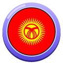 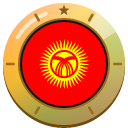

1. [Photograph the Manas statue on Ala-Too Square in daylight.](https://cogvivo.com/en/challenge/land-kg-1)
2. [Take a selfie in Ala Archa with the mountains behind you.](https://cogvivo.com/en/challenge/land-kg-2)
3. [Photograph a place outside Bishkek in daylight: choose one from the list.](https://cogvivo.com/en/challenge/land-kg-3)
4. [Taste beshbarmak or boorsok. Film your reaction.](https://cogvivo.com/en/challenge/land-kg-4)
5. [Film yourself: say hello and order something in Kyrgyz.](https://cogvivo.com/en/challenge/land-kg-5)

**[▶ Open Kyrgyzstan on Cogvivo](https://cogvivo.com/en/country/KG)**

## Lebanon

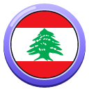 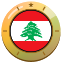

1. [Photograph the Pigeon Rocks of Raouché in Beirut in daylight.](https://cogvivo.com/en/challenge/land-lb-1)
2. [Take a selfie with the Mohammad al-Amin Mosque behind you.](https://cogvivo.com/en/challenge/land-lb-2)
3. [Photograph a monument outside Beirut in daylight: choose one from the list.](https://cogvivo.com/en/challenge/land-lb-3)
4. [Taste manakish with za'atar or tabbouleh. Film your reaction.](https://cogvivo.com/en/challenge/land-lb-4)
5. [Film yourself: say hello and order something in Arabic.](https://cogvivo.com/en/challenge/land-lb-5)

**[▶ Open Lebanon on Cogvivo](https://cogvivo.com/en/country/LB)**

## Maldives

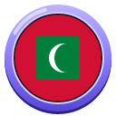 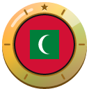

1. [Photograph the Old Friday Mosque (Hukuru Miskiy) from outside in daylight.](https://cogvivo.com/en/challenge/land-mv-1)
2. [Take a selfie on Hulhumalé Beach with the lagoon behind you.](https://cogvivo.com/en/challenge/land-mv-2)
3. [Photograph a place outside Malé: choose one from the list.](https://cogvivo.com/en/challenge/land-mv-3)
4. [Taste mas huni or garudhiya. Film your reaction.](https://cogvivo.com/en/challenge/land-mv-4)
5. [Film yourself: say hello and order something in Dhivehi.](https://cogvivo.com/en/challenge/land-mv-5)

**[▶ Open Maldives on Cogvivo](https://cogvivo.com/en/country/MV)**

## Nepal

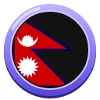 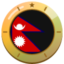

1. [Photograph the whole Boudhanath Stupa in daylight.](https://cogvivo.com/en/challenge/land-np-1)
2. [Take a selfie on Durbar Square with the temples behind you.](https://cogvivo.com/en/challenge/land-np-2)
3. [Photograph a place outside Kathmandu in daylight: choose one from the list.](https://cogvivo.com/en/challenge/land-np-3)
4. [Taste dal bhat or momo. Film your reaction.](https://cogvivo.com/en/challenge/land-np-4)
5. [Film yourself: say hello and order something in Nepali.](https://cogvivo.com/en/challenge/land-np-5)

**[▶ Open Nepal on Cogvivo](https://cogvivo.com/en/country/NP)**

## Oman

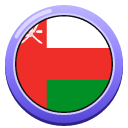 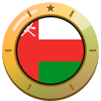

1. [Photograph the Sultan Qaboos Grand Mosque from outside in daylight.](https://cogvivo.com/en/challenge/land-om-1)
2. [Take a selfie on the Mutrah Corniche with the fort behind you.](https://cogvivo.com/en/challenge/land-om-2)
3. [Photograph a fort outside Muscat in daylight: choose one from the list.](https://cogvivo.com/en/challenge/land-om-3)
4. [Taste shuwa or Omani halwa. Film your reaction.](https://cogvivo.com/en/challenge/land-om-4)
5. [Film only yourself: say hello and order something in Arabic.](https://cogvivo.com/en/challenge/land-om-5)

**[▶ Open Oman on Cogvivo](https://cogvivo.com/en/country/OM)**

## Pakistan

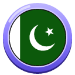 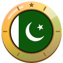

1. [Photograph the Badshahi Mosque from outside in daylight.](https://cogvivo.com/en/challenge/land-pk-1)
2. [Take a selfie at the Alamgiri Gate of Lahore Fort.](https://cogvivo.com/en/challenge/land-pk-2)
3. [Photograph a monument outside Lahore in daylight: choose one from the list.](https://cogvivo.com/en/challenge/land-pk-3)
4. [Taste nihari or halwa puri. Film your reaction.](https://cogvivo.com/en/challenge/land-pk-4)
5. [Film yourself: say hello and order something in Urdu.](https://cogvivo.com/en/challenge/land-pk-5)

**[▶ Open Pakistan on Cogvivo](https://cogvivo.com/en/country/PK)**

## Palestine

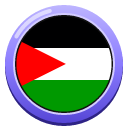 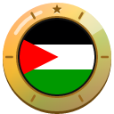

1. [Photograph the Church of the Nativity from outside in daylight, from Manger Square.](https://cogvivo.com/en/challenge/land-ps-1)
2. [Take a selfie at Solomon's Pools near Bethlehem.](https://cogvivo.com/en/challenge/land-ps-2)
3. [Photograph a monument outside Bethlehem in daylight: choose one from the list.](https://cogvivo.com/en/challenge/land-ps-3)
4. [Taste musakhan or vegetable maqluba. Film your reaction.](https://cogvivo.com/en/challenge/land-ps-4)
5. [Film yourself: say hello and order something in Arabic.](https://cogvivo.com/en/challenge/land-ps-5)

**[▶ Open Palestine on Cogvivo](https://cogvivo.com/en/country/PS)**

## Qatar

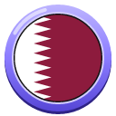 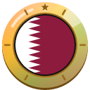

1. [Photograph the whole Museum of Islamic Art in daylight.](https://cogvivo.com/en/challenge/land-qa-1)
2. [Take a selfie at Souq Waqif or Katara with the buildings behind you.](https://cogvivo.com/en/challenge/land-qa-2)
3. [Photograph a place outside Doha in daylight: choose one from the list.](https://cogvivo.com/en/challenge/land-qa-3)
4. [Taste machboos or balaleet. Film your reaction.](https://cogvivo.com/en/challenge/land-qa-4)
5. [Film only yourself: say hello and order something in Arabic.](https://cogvivo.com/en/challenge/land-qa-5)

**[▶ Open Qatar on Cogvivo](https://cogvivo.com/en/country/QA)**

## Saudi Arabia

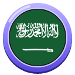 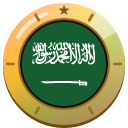

1. [Photograph the whole Masmak Fortress in daylight.](https://cogvivo.com/en/challenge/land-sa-1)
2. [Take a selfie with the mud-brick buildings of At-Turaif behind you.](https://cogvivo.com/en/challenge/land-sa-2)
3. [Photograph a monument outside Riyadh in daylight: choose one from the list.](https://cogvivo.com/en/challenge/land-sa-3)
4. [Taste kabsa or jareesh. Film your reaction.](https://cogvivo.com/en/challenge/land-sa-4)
5. [Film only yourself: say hello and order something in Arabic.](https://cogvivo.com/en/challenge/land-sa-5)

**[▶ Open Saudi Arabia on Cogvivo](https://cogvivo.com/en/country/SA)**

## Sri Lanka

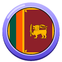 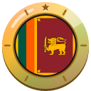

1. [Photograph the whole Jami Ul-Alfar Mosque from outside in daylight.](https://cogvivo.com/en/challenge/land-lk-1)
2. [Take a selfie on Galle Face Green with the sea behind you.](https://cogvivo.com/en/challenge/land-lk-2)
3. [Photograph a place outside Colombo in daylight: choose one from the list.](https://cogvivo.com/en/challenge/land-lk-3)
4. [Taste kottu roti or hoppers. Film your reaction.](https://cogvivo.com/en/challenge/land-lk-4)
5. [Film yourself: say hello and order something in Sinhala or Tamil.](https://cogvivo.com/en/challenge/land-lk-5)

**[▶ Open Sri Lanka on Cogvivo](https://cogvivo.com/en/country/LK)**

## Syria

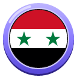 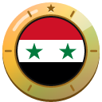

1. [Photograph the whole Umayyad Mosque from outside in daylight.](https://cogvivo.com/en/challenge/land-sy-1)
2. [Take a selfie in the courtyard of Azm Palace.](https://cogvivo.com/en/challenge/land-sy-2)
3. [Photograph a monument outside Damascus in daylight: choose one from the list.](https://cogvivo.com/en/challenge/land-sy-3)
4. [Taste kibbeh or fattoush. Film your reaction.](https://cogvivo.com/en/challenge/land-sy-4)
5. [Film yourself: say hello and order something in Arabic.](https://cogvivo.com/en/challenge/land-sy-5)

**[▶ Open Syria on Cogvivo](https://cogvivo.com/en/country/SY)**

## Tajikistan

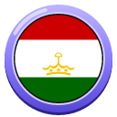 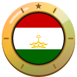

1. [Photograph the Ismoil Somoni Monument in daylight.](https://cogvivo.com/en/challenge/land-tj-1)
2. [Take a selfie in Rudaki Park with the Rudaki statue behind you.](https://cogvivo.com/en/challenge/land-tj-2)
3. [Photograph a place outside Dushanbe in daylight: choose one from the list.](https://cogvivo.com/en/challenge/land-tj-3)
4. [Taste qurutob or osh (plov). Film your reaction.](https://cogvivo.com/en/challenge/land-tj-4)
5. [Film yourself: say hello and order something in Tajik.](https://cogvivo.com/en/challenge/land-tj-5)

**[▶ Open Tajikistan on Cogvivo](https://cogvivo.com/en/country/TJ)**

## Turkmenistan

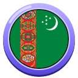 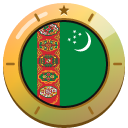

1. [Photograph the Ertuğrul Gazi Mosque from outside in daylight.](https://cogvivo.com/en/challenge/land-tm-1)
2. [Take a selfie with the Neutrality Monument behind you.](https://cogvivo.com/en/challenge/land-tm-2)
3. [Photograph a place outside Ashgabat in daylight: choose one from the list.](https://cogvivo.com/en/challenge/land-tm-3)
4. [Taste palaw or pumpkin gutap. Film your reaction.](https://cogvivo.com/en/challenge/land-tm-4)
5. [Film yourself: say hello and order something in Turkmen.](https://cogvivo.com/en/challenge/land-tm-5)

**[▶ Open Turkmenistan on Cogvivo](https://cogvivo.com/en/country/TM)**

## United Arab Emirates

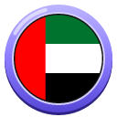 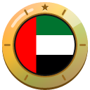

1. [Photograph the whole Burj Khalifa in daylight.](https://cogvivo.com/en/challenge/land-ae-1)
2. [Take a selfie in Al Fahidi with the wind towers behind you.](https://cogvivo.com/en/challenge/land-ae-2)
3. [Photograph a monument outside Dubai in daylight: choose one from the list.](https://cogvivo.com/en/challenge/land-ae-3)
4. [Taste machboos or luqaimat. Film your reaction.](https://cogvivo.com/en/challenge/land-ae-4)
5. [Film only yourself: say hello and order something in Arabic.](https://cogvivo.com/en/challenge/land-ae-5)

**[▶ Open United Arab Emirates on Cogvivo](https://cogvivo.com/en/country/AE)**

## Uzbekistan

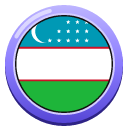 

1. [Photograph the Gur-e-Amir Mausoleum from outside in daylight.](https://cogvivo.com/en/challenge/land-uz-1)
2. [Take a selfie on the Registan with the madrasas behind you.](https://cogvivo.com/en/challenge/land-uz-2)
3. [Photograph a monument outside Samarkand in daylight: choose one from the list.](https://cogvivo.com/en/challenge/land-uz-3)
4. [Taste plov or pumpkin samsa. Film your reaction.](https://cogvivo.com/en/challenge/land-uz-4)
5. [Film yourself: say hello and order something in Uzbek.](https://cogvivo.com/en/challenge/land-uz-5)

**[▶ Open Uzbekistan on Cogvivo](https://cogvivo.com/en/country/UZ)**

## Yemen

 

1. [Photograph the Cisterns of Tawila in Aden in daylight.](https://cogvivo.com/en/challenge/land-ye-1)
2. [Take a selfie with Sira Fortress behind you.](https://cogvivo.com/en/challenge/land-ye-2)
3. [Photograph a monument outside Aden in daylight: choose one from the list.](https://cogvivo.com/en/challenge/land-ye-3)
4. [Taste saltah or bint al-sahn. Film your reaction.](https://cogvivo.com/en/challenge/land-ye-4)
5. [Film yourself: say hello and order something in Arabic.](https://cogvivo.com/en/challenge/land-ye-5)

**[▶ Open Yemen on Cogvivo](https://cogvivo.com/en/country/YE)**

---

© 2026 Tim Wijnands. Cogvivo™, its texts, challenges and badges are protected: public to view and to help with, not to copy or reuse. See [LICENSE](../../LICENSE).

*This page is generated automatically from the app. Changes made here by hand are overwritten.*
